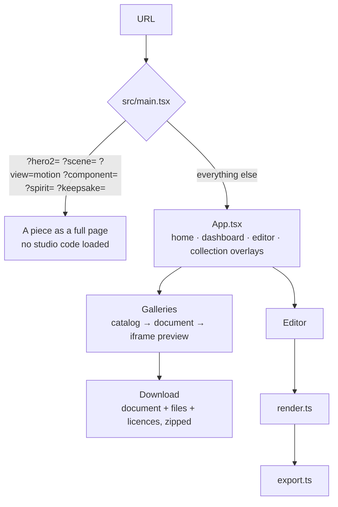

# How Patchwork fits together

## Routing

`src/main.tsx` reads the URL before anything else. A piece opened on its own renders as a complete page without loading the studio: `?hero2=`, `?view=hero&hero=` (the original five), `?scene=`, `?view=motion&motion=`, `?component=`, `?spirit=` and `?keepsake=`. Each collection has a tiny `route.ts`, with no imports, that it can check cheaply. Every other URL loads `App.tsx`: the home page, the dashboard, the editor, and the collection overlays (`?collection=…`). Overlays push a history entry, so Back closes them.

## One shape for every collection

| File | Job |
|---|---|
| `catalog.ts` | Ids, names, descriptions, palettes, default words and options, plus `normalize…` to validate anything a person typed or a URL carried. |
| `document.ts` | The **complete page** for a piece: used by the gallery preview (`srcdoc`), the standalone page and the download, so all three are the same page. It also has the list of files a download needs. |
| `gallery.ts` | The gallery and the customiser. |
| `route.ts` | Which ids exist, for `main.tsx`. A piece missing from here won't open. |

The pieces themselves are plain files under `public/<collection>/`. Some engines have a build step: `src/diorama` → `public/diorama/diorama.js`, `src/particles` → `public/heroes2/<id>/hero.js`, `src/motion` → `public/motion/engine.js`, `src/ascii` → `runtime.generated.js`. Edit the source, never the output.

## Websites people make

A project (`src/types.ts`) is a list of sections. Each section has a kind, a world, words, an optional background, decorations and motion. `render.ts` turns a project into markup scoped under `.pw-*`. The editor shows that markup in an iframe, and `export.ts` zips the same markup with `site.css`, fonts, assets and `site.js`, which is the ASCII runtime plus a small script for motion and visibility. See [the studio](sections/studio.md).

Storage is IndexedDB (`storage.ts`): projects, uploaded assets referenced as `asset:<uuid>`, validation on import, and editable project bundles.

## The shell

`src/shell/` holds the shared top bar (`ShellBar.tsx`, with the list of collections in `collections.ts`), page styles, and the [brand kit](sections/brand-kit.md).

## Where to read next

- [Sections](README.md#sections-what-each-part-of-the-site-is): one page per part of the site.
- [Engines](README.md#engines-how-things-move): one page per engine.
