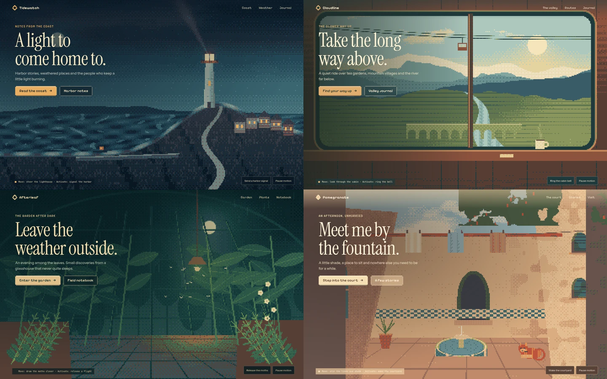

# Scenes

Living pixel-art places for backgrounds and landing pages, separate from every hero collection. Made after studying the scenes on piixpal.dvkk.dev for mood and craft (painted, palette-limited, pointer-aware places); every scene, palette and line of code here is original.

- Studio: `/?collection=scenes` (dashboard: **Scenes**). Clicking a scene opens it alone in a new tab; **Customize** loads it into the editor: brand, small line, headline, sentence, both buttons, main link, pixel size (3 to 6) and whether the words show at all (off: the scene alone as a background). Settings save in `localStorage` (`patchwork-scenes-v1`). The preview renders a true 1440x900 page and scales it down.
- A scene alone: `/?scene=<id>`.
- Download: a ZIP with `index.html`, `base.css`, `pixel.js`, `<id>/scene.js`, five local fonts with their OFL licences, `recipe.json` and a README. No network requests.

## How a scene is made

`public/scenes/pixel.js` is a small runtime. A scene calls `PixelScene({ palette, frag, ... })` where `frag` defines `vec3 scene(vec2 uv, vec2 px)`. The runtime renders at 1/pixel resolution, adds a 4x4 Bayer offset and snaps every pixel to the nearest colour of the scene's own palette (up to 16), then the canvas is scaled up with `image-rendering: pixelated`. It smooths the pointer (`uMouse`), reports clicks (`uClick` seconds since, `uClickPos`), dissolves the scene in on arrival, pauses offscreen and in hidden tabs, and draws one still frame for reduced motion. `raw: true` skips the palette (Riso uses it for real two-ink overprint).

| id | Name | What happens | Pointer · click |
|---|---|---|---|
| `lastbus` | Last Bus | Rainy street at night: hazy towers with lit rooms, a buzzing neon sign, sodium lamp and its pool of light, bus shelter with a backlit poster, the last bus with riders, wet road mirroring the lights | wind in the rain · lightning |
| `kelp` | Kelp | Sun shafts, three depths of swaying kelp with golden floats, caustics on sand, bubbles, a manta far behind | lead the fish school · scatter it |
| `longnight` | Long Night | Aurora curtains, lit peaks with snowlines, pines, a cabin with a warm window and chimney smoke, three depths of snow | wind and window glow · shooting star |
| `rooftops` | Rooftops | Golden-hour roof: washing on a line, string lights, water tower, mast light, pigeons on the parapet, herbs in pots | wind in the washing · pigeons take off |
| `riso` | Riso Swell | Two inks on paper, each its own plate and grain, multiplying where they overlap: retro sun, sun road, crests, a sailboat, gulls | registration and sun height · re-ink in the next pair |
| `lanterns` | Lantern River | Blue hour in a gorge: stone bridge with lanterns, sky lanterns rising, floating lanterns coming downstream, reflections | wind for the lanterns · release more |

## Four original additions — 12 November 2026

The original six remain in their original order. Four new places bring the collection to ten:

| id | Name | What happens | Pointer · action |
|---|---|---|---|
| `tidewatch` | Tidewatch | A tapered lighthouse, balcony rail, masonry, tiled cottages, working harbor, trawler, rain and a tide-cut headland | steer the beam · send a harbor signal |
| `cloudline` | Cloudline | A timber cable-car bay over terraced tea gardens, a viaduct, layered ridges, passing gondola, ticket and steaming cup | look around · ring the cabin bell and send birds into the valley |
| `glasshouse` | Glasshouse | A curved iron-and-glass conservatory, wet panes, brass pendant, banana leaves, fern beds, orchids and moths | gather moths at the pointer · release a new flight |
| `courtyard` | Pomegranate Court | Perspective plaster walls, blue shutters, linen, tiled passage, mosaic fountain, leaf shade and a ginger cat | stir the shade · ripple the water and wake the courtyard |

Each new scene has real keyboard-accessible artwork and pause/resume buttons. Its visual remains available as a words-off background and a complete local download. The controls are opt-in via `PixelScene({controls: ...})`, so the original six scenes retain their existing presentation. All four are original procedural shader paintings; no reference-site imagery, layout code, shaders or dependencies are included.

Reference study: the supplied piixpal UI index, dot-cat hero, castle and train-window pages were opened in Chromium and reviewed for palette discipline, silhouette, parallax and interaction. These references informed craft and depth, not copied subject arrangements. Tidewatch, the cable-car tea valley, the conservatory and Pomegranate Court use their own compositions and details.

## Files

- `src/scenes/`: `catalog.ts` (ids, defaults, validation), `document.ts` (page markup shared by preview, standalone and download), `gallery.ts|css`, `entry.ts`, `route.ts`.
- `public/scenes/`: `pixel.js`, `base.css`, one folder per scene, `fonts/`, `licenses/`.
- Shared files touched: `src/main.tsx` (one route branch) and `src/App.tsx` (one dashboard button).

## Verification (11 November 2026)

`tests/scenes.test.ts`: six scenes, complete pages, every packaged file exists, pointer and click handled, palettes within 16, reduced motion and offscreen pausing, escaping, unsafe links, pixel-size validation, the words-off mode, routes separate from the hero collections. Chromium at 1440x900 on an Intel Iris G1: all six at 60 fps, no console errors, no overflow; each scene and its text layout reviewed visually and tuned. Customise, new tab and a downloaded ZIP served on its own (local requests only, fonts loaded, custom words and 6 px pixels kept) were exercised. Phone layouts have basic rules but were not reviewed.

## Expansion verification (12 November 2026)

75 unit tests and the production build pass. `scripts/verify-scene-expansion.mjs` passes against the production output: ten cards, four independent openings, four actual customized ZIP downloads served on an isolated local origin, local assets only, initialized shaders, pointer and keyboard actions, stable paused artwork, reduced-motion stills, and desktop/tablet/phone framing. Desktop and phone renders were visually reviewed. This expands the collection; the six original painting files remain unchanged. See `docs/VERIFICATION.md` for evidence and limits.
