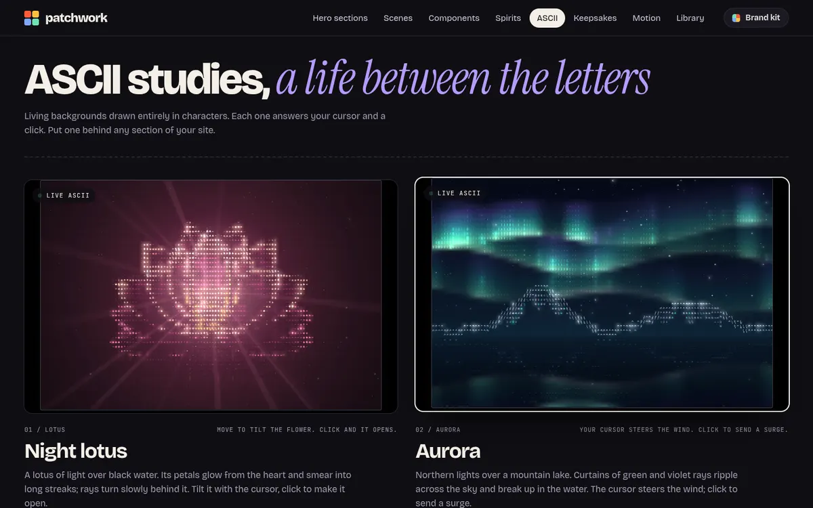

# ASCII: living light made of characters

> Engine · `src/ascii/` → `src/ascii/runtime.generated.js` (`npm run build:ascii`). It ships inside every exported site as part of `site.js`. Used by the ASCII backgrounds in the editor and the ASCII collection.



## The pieces

| File | Job |
|---|---|
| `cells.ts` | `CellFrame`: the cell grid. A dark ground, optional shaded blocks, then glyphs batched by colour and brightness, so a frame costs one `fillStyle` change per bucket and not one per cell. |
| `kit.ts` | Shared tools: brightness ramps (each scene picks the alphabet that suits its material), value noise and fbm, and a light buffer. Scenes paint light into the buffer, can smear bright cells into long-exposure streaks, and emit glyphs in one pass. |
| `lotus.ts`, `aurora.ts`, `neon.ts`, `koi.ts` | The four scenes: Night lotus, Aurora, Neon rain, Koi pond. |
| `paint.ts` | *Your painting*: any picture turned into breathing characters. The picture is sampled at one pixel per cell and its colours are gathered into a small palette. A shimmer and a slow beam of light run through it, the brightest strokes streak and sparkle, the cursor is a lens and a click sends a ripple. |
| `daylight.ts` | Living sites: turns the visitor's local hour into `night` (0 at midday, 1 at deep night) and `twilight` (1 at sunrise and sunset). No location and no network. |
| `entry.ts` | Finds every `canvas[data-ascii]`, starts its scene, and drives living sites (`data-daypart`, `--night`, `--twilight` on the site root). |

## A scene

```ts
interface AsciiScene {
  palette: RGB[]; background: string;
  resize(w: number, h: number, frame: CellFrame): void;
  step(dt: number): void;                       // advance the simulation
  render(frame: CellFrame, ctx?): void;         // write glyphs into the frame
  underlay?(ctx, frame): void;                  // painted under the glyphs (e.g. the picture's glow)
  overlay?(ctx, frame): void;                   // after the glyphs, before bloom
  bloom?: number;
}
```

## The paint studio

`src/PaintStudio.tsx` is a small painting app (brushes, a palette, photo or starter pictures) whose canvas becomes the *Your painting* scene. Exports inline the painting as a data URL, so a site opened from `file://` can still read it.

## Rules

Scenes pause offscreen and in hidden tabs, and draw a still frame for reduced motion. The generated runtime is a build output: edit `src/ascii/*.ts` and rebuild, never the `.generated.js`.
