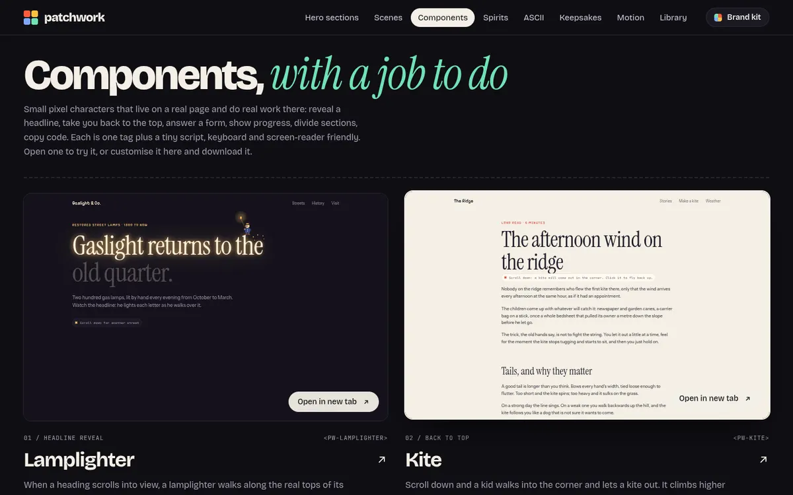
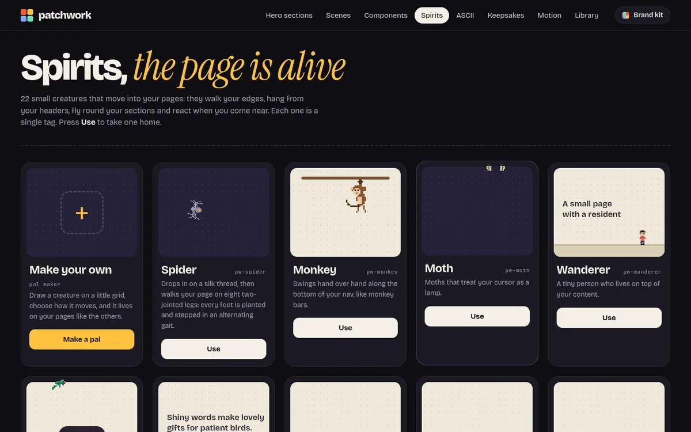

# Creature kit: sprites that live on a real page

> Engine · `public/components/kit.js` and `public/spirits/kit.js` (the same kit), plus `public/spirits/pals.js`. No build step. Used by every Component and Spirit.

  
  

Components and Spirits are little pixel characters that are **custom elements**. You drop a tag such as `<pw-lamplighter>` or `<pw-spider>` into any page, and the character measures the page around it and lives there.

## The kit

`kit.js` loads first and puts one small API on `window.PW`:

| | |
|---|---|
| `PW.sprite(rows, palette)` | Pixel art from strings (`"..kkkk.."`, `.` is transparent), drawn once to a tiny canvas. |
| `PW.draw(ctx, sprite, x, y, scale, flip, rot)` | Draws a sprite with its bottom-centre at (x, y), without smoothing. |
| `PW.stage(actor)` | **One** shared, click-through canvas over the whole page. Every creature on the page draws into it from its `frame(ctx, dt, t)` method. The loop sleeps when no actor is busy and nobody is scrolling, and wakes on scroll, pointer moves, resize and tab focus. |
| `PW.snap / dot / line / blob` | Procedural pixel art that snaps to the creature's pixel size, so drawn limbs and bodies stay as crisp as sprites. |
| `PW.scroll.v`, `PW.pointer` | Smoothed scroll speed in px/s (the Kite leans with it, the Tightrope walker slips), and the shared pointer. |
| `PW.say(text)` | A polite live-region announcement for screen readers. |
| `PW.bubble(...)` | A pixel speech bubble. |
| `PW.reduced` | True when the visitor asked for less motion. Creatures then show a still pose. |

Anything particular to one creature lives in that creature's own file. For example, the Lamplighter measures the real tops of a heading's letters from the font so it can walk on them.

## Components: characters with a job

| Tag | Job |
|---|---|
| `pw-lamplighter` | Headline reveal: walks along the letters and lights them. |
| `pw-kite` | Back-to-top: a kid lets a kite out as you read; click to be reeled back up. |
| `pw-postie` | Form helper: points at the field with the mistake, posts the letter when it's right. |
| `pw-cocoon` | Progress bar: silk wraps up as the value rises, and a butterfly emerges at 100. |
| `pw-tightrope` | Divider: an acrobat on a rope that bends under him, and slips if you scroll too fast. |
| `pw-mimeo` | Copy-code button: a tiny copier that prints a slip, or jams if the clipboard is blocked. |

Each one wraps or sits beside a real element (a heading, a `<progress>`, a `<button>`, a form), so screen readers and keyboards get the real thing. The character is decoration.

## Spirits: characters that just live there

22 creatures, each with its own way of moving: the Spider drops on silk and walks on eight two-jointed legs, the Monkey swings, the Moth circles your cursor, the Hummingbird hovers, and more. `pals.js` is one engine for many small pals. Each pal has a palette, move frames, an idle and a react frame, a way of moving (walk, hop, crawl, fly, hang, sit) and a way of reacting to you.

The **pal maker** (`src/spirits/maker.ts`) lets anyone draw a creature on a small grid, pick how it moves, and get a working `<pw-pal>`.

## Adding one

1. `public/components/<id>.js` (or `public/spirits/<id>.js`) that defines the custom element and starts with a comment listing its attributes.
2. A catalog entry with its options (`color`, `text`, `number`, `select`). The gallery builds the customiser, the snippet and the download from it.
3. Make sure a keyboard user can operate anything clickable, and that reduced motion still shows something useful.
