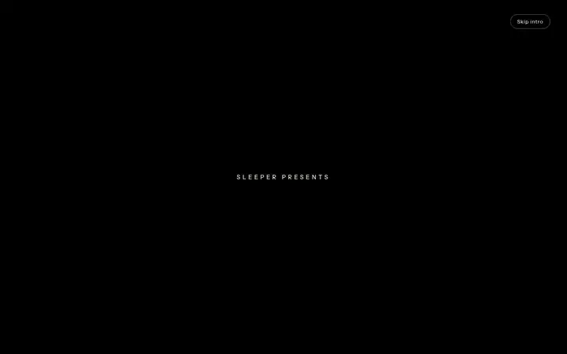

# Diorama: paintings that move in 3D

> Engine · `src/diorama/engine.ts` → `public/diorama/diorama.js` (`npm run build:diorama`, also copied into `public/heroes2/vendor/` and `public/scenes/`). WebGL2, no dependencies. Used by: Reading Room, Forge and Tea House heroes; Onsen, Arcade, Sky Isle and the three title-card scenes; the Overnight motion template.



Diorama takes two images — a painting and its depth map — and renders them as a small 3D place in WebGL2. It has no dependencies (about 22 KB minified).

## What it does each frame

1. **Depth.** The painting is ray-marched against its own depth map (steep parallax: a coarse march from the nearest plane to the farthest, then a binary search inside the step). When the camera moves, near things slide over far things and hide what is behind them.
2. **Light.** Bright, warm, saturated pixels become a light layer that flickers in small patches.
3. **Bloom** (two separable blur passes) and **god rays** (a radial blur of the light towards `light.x/y`).
4. **Air and water.** Fog that thickens with distance; a ripple below a waterline.
5. **Particles** on the GPU — dust, embers, snow, rain, fireflies, steam, petals, sparks, bubbles — each at a real depth and hidden when something nearer is in front. Any system can be a one-shot burst.
6. **Title plane** (optional). Lettering hung at a chosen depth inside the picture: the ray marcher shows it only where the ray reaches that depth before it meets the painting, so a branch or a jellyfish nearer than the title passes in front of the letters, and the letters cast a soft shadow on what lies behind. Draw the lettering on a transparent canvas the painting's size and hand it over with `setTitle(canvas)`; redraw and call it again to animate. [Title cards](title-cards.md) are built on top of it.
7. **Pixels** (optional). Render at 1/`pixel` resolution and scale up crisply; optionally snap to an automatic palette with ordered dithering (`palette`, `paletteFrom`).

It pauses offscreen, in hidden tabs and when someone asks it to (`pause()`), and draws a single still frame for reduced motion. If WebGL2 or the images fail, the painting is shown as a plain background.

## Using it

```js
const d = new Diorama(canvas, {
  color: "painting.webp", depth: "depth.webp",
  depthScale: .05, focus: .45, pointer: 1,      // how far near things travel, which depth stays still, cursor parallax
  glow: { threshold: .75, strength: .8, flicker: .2, tint: [1, .8, .5] },
  rays: { x: .85, y: .15, strength: .9 },
  fog: [.3, .2, .1, .25], water: { y: .7, strength: 1 },
  particles: [{ kind: "dust", count: 900, color: [1, .9, .7], region: [.3, 0, 1, .8], depth: [.3, 1] }],
  pixel: 0,                                       // 3–6 for pixel art
});
d.cam.zoom = 1.4; d.cam.x = -1;                   // animate cam.{x,y,zoom,cx,cy,dolly} with GSAP
d.pulse(x, y); d.burst(index, x, y);              // a ripple; fire a burst system
d.light.boost = 1;                                // brighten every light
// with { title: { depth: .3, glow: .5, shadow: .4 } } in the options:
d.setTitle(letteringCanvas);                      // a transparent canvas the painting's size
```

Setting the focus near the main subject keeps big foreground objects from stretching.

## Making a new painted piece

1. **Paint it.** Generate a 16:9 painting with layered depth: a clear foreground, midground and background, and room for words. Pixel pieces ask for "refined 32-bit pixel art"; others for a painterly illustration.
2. **Depth map.** Give the painting back to the image model as an edit: "the same scene as a grayscale depth map, white nearest, black farthest, pixel-aligned, no texture". The results line up with the painting closely.
3. **Prepare.** `vips copy painting.png "painting.webp[Q=86]"`; for the depth map, convert to grey, blur slightly (`vips gaussblur … 1.4–2.4`; more for foliage) and save as `depth.webp[Q=90]`.
4. **Tune** in a browser with the GPU on. Look for stretching at depth edges (lower `depthScale`, move `focus` to the subject, blur the depth more) and for text contrast.

## The paintings

All generated with ChatGPT image generation for Patchwork, 12 November 2026. Prompts, shortened:

| Piece | Prompt |
|---|---|
| Reading Room | A vast ancient library hall, bookshelves receding, tall arched windows throwing slanting shafts of golden sunlight through dust, a long reading table with an open book and a brass lamp in the foreground; left side calmer for a headline. |
| Forge | A blacksmith's forge at night, glowing coals in a stone hearth on the right, an anvil with a red-hot blade in the foreground, sparks, tools in silhouette; left side dark for a headline. |
| Tea House | A wooden tea house on stilts in a misty bamboo forest in early morning, paper lanterns lit, a mossy stone path, bamboo layers fading into mist; left side open mist. |
| Onsen | Pixel art: an outdoor hot spring at night in snowy mountains, steaming turquoise pool, an inn with glowing paper windows and lanterns, a full moon. |
| Arcade | Pixel art: inside a small arcade at night, cabinets receding with invented abstract screens, pink and cyan neon, a claw machine, rain on the front window. |
| Sky Isle | Pixel art: a floating island with a small temple and waterfalls above a sea of clouds at sunrise, floating rocks, birds, sun rays. |
| Hayfield | Pixel art: late-summer golden hour over rolling farmland, an old oak reaching in from the right, a red barn and a windmill, open sky in the upper centre for a film title. |
| Blue Room | Pixel art: inside a dim aquarium hall, one enormous curved tank with glowing jellyfish at different distances, a manta far back, a bench in silhouette; open water in the middle for a title. |
| Night Train | Pixel art: a lit night train on a stone viaduct over a lake town, a signal post and an oak on the near hill, mountains and a crescent moon; open starry sky for a title. |
| Overnight (4) | Pixel art, one sleeper train: the night platform under an iron-and-glass canopy; the train crossing a moonlit lake; a stone viaduct over a misty gorge at sunrise; arriving at a seaside terminus in the morning. The last three were generated with the first as a style reference. |

Each depth map was made from its painting with the depth prompt above.
