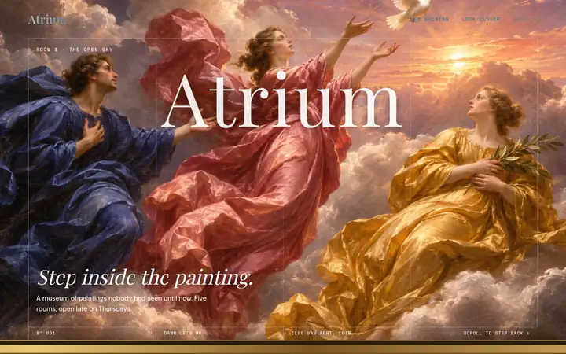
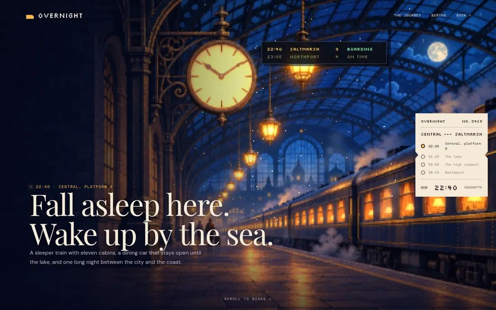

# Motion runtime: scroll-told websites

> Engine · `src/motion/runtime.ts` (with GSAP + ScrollTrigger, three.js and Diorama) → `public/motion/engine.js` (`npm run build:motion`). Used by every Motion template.

  
  

A Motion template is a whole website whose story is told by scrolling. Each one is three things:

| Part | Where | What it does |
|---|---|---|
| Markup | `src/motion/templates.ts` → `render<Name>(config)` (e.g. `atrium.ts`) | The complete page from the visitor's words: brand, headline, email. Everything is escaped. |
| Style | `src/motion/<name>.css`, joined by `document.ts` | The template's own look, scoped under `.mt-page`. |
| Choreography | `src/motion/<name>-runtime.ts`, called from `runtime.ts` | GSAP timelines pinned to scroll, plus any interaction. Returns a cleanup function. |

`runtime.ts` reads `data-template` on `.mt-page` and starts the right choreography. It hands every template the same two flags: `reduced` (show finished states, no pinning) and `mobile` (shorter pins, simpler cameras).

## Families

- **3D objects** (`scene.ts`, `MotionScene`): three.js objects that turn, explode and reassemble on a `Pose` (turn, explode, bloom, lift, scale, roll) that scroll animates. Æther, Monolith and the other object templates use it.
- **Stories** (`*-story.ts`, `*-world.ts`): illustrated multi-chapter pieces such as Burrow, Cloudwhale, Goldseam and The Last Lightkeeper.
- **Painted** (Diorama): Overnight is four pixel paintings rendered in depth, with a ticket that is punched at every stop.
- **Gallery**: Atrium, an imagined museum. You start inside a painting and scroll back until it hangs on the wall. Then comes a sideways walk where frames turn toward you, a 2.6× loupe for the brushwork, a painting you can zoom into detail by detail with guide notes, and a ticket desk.
- **Living** (`living/`): landing pages built around one slowly moving specimen (a fern, a seed head, a spiral).
- **Studies** (`studies.ts`, `glyph-*`, `image-*`): smaller pieces on one technique.

## Adding a template

1. An entry in `src/motion/catalog.ts` (number, category, cover, chapters, tags).
2. `render<Name>` dispatched from `templates.ts`, `<name>.css` added in `document.ts`, and `animate<Name>` called from `runtime.ts`, with its cleanup.
3. Images go in the export manifest (`image-assets.ts`) and their licences in the export README.
4. `npm run build:motion`, then scroll it top to bottom, on desktop and at 390 px, with the GPU on.

Templates download as a folder with `engine.js`, their images, fonts and licences.
