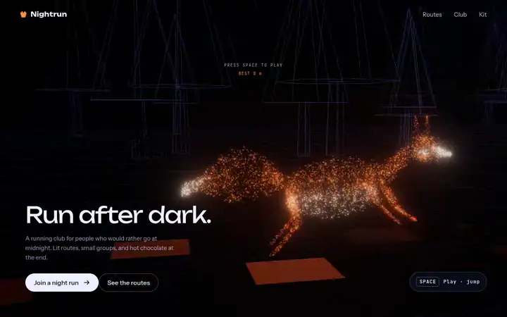
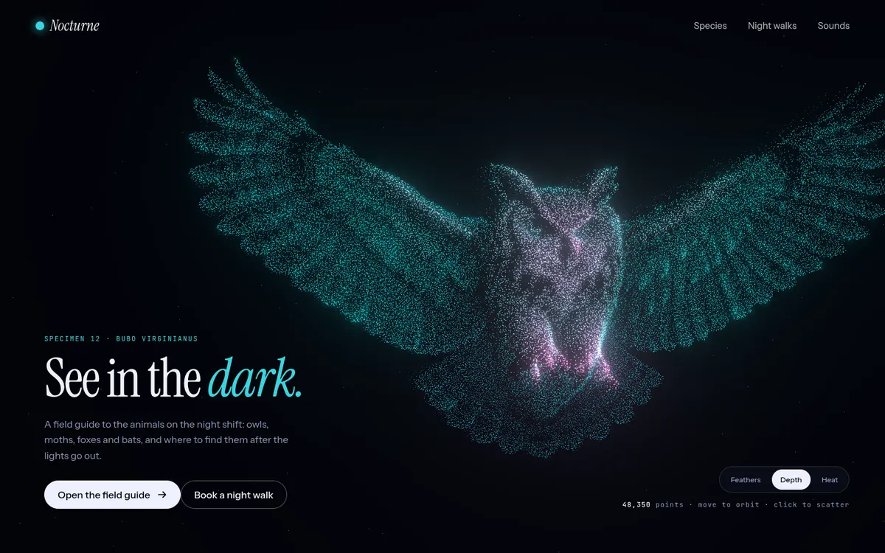

# Particle worlds: creatures made of light

> Engine · `src/particles/*.ts` → each one bundled with three.js into `public/heroes2/<id>/hero.js` (`npm run build:particles`, with the three.js MIT notice in `public/heroes2/licenses/`). Used by the Night Run and Nocturne heroes.

  
  

## Night Run (`runner.ts`)

A fox with no mesh. It is a small procedural skeleton: spine, neck, head, ears, a tail, and four two-bone legs on a gallop cycle. 5,200 particles are pinned to its parts and re-posed every frame, and a share of them peel off as a glowing trail. The forest is wireframe trees that scroll past on a path of thumbnails.

It runs by itself (attract mode) until someone presses Space or taps. From then on it's a game: jump logs and rocks, catch fireflies, and a counter keeps the distance and the best run. Points are drawn additively with bloom, so the fox glows where particles overlap. Phones get their own camera framing.

## Nocturne (`owl.ts`)

An owl built from a generated painting and its depth map. Every bright enough pixel of the painting becomes a point (about 48,000), and the depth map pushes each point toward or away from the camera. Everything else happens in the vertex shader:

- **Wing-beat**: a wave that starts at the shoulders and travels out to the tips, lifting the wings and bringing them forward.
- **Scatter**: a click blows every point out along its own random direction, then the owl gathers again.
- **Colour modes**: the feathers' own colour, depth shown as light, and heat. Modes cross-fade.

The pointer orbits the camera around the owl.

## Notes

- Start the scene at the **end** of the file (`const root = …; if (root) start(root)`). esbuild bundles into an IIFE, and a top-level start call placed above the constants it uses hits them before they're initialised (a temporal dead zone error).
- Judge frame rate with the GPU on (`--use-angle=vulkan --enable-gpu`). Software WebGL in headless Chromium is far slower.
