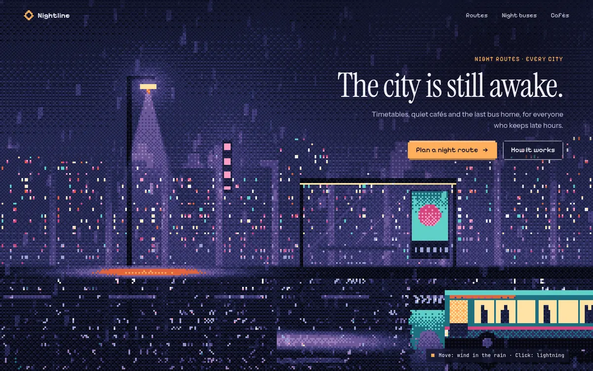

# Pixel scenes: one fragment shader, one palette

> Engine · `public/scenes/pixel.js` (no build step, about 150 lines). Used by the ten procedural scenes: Last Bus, Kelp, Long Night, Rooftops, Riso Swell, Lantern River, Tidewatch, Cloudline, Glasshouse and Pomegranate Court.



Each procedural scene is a single GLSL function, `vec3 scene(vec2 uv, vec2 px)`, painted at a fraction of the screen's resolution. Every pixel is then snapped to the scene's own palette of up to 16 colours through a 4 × 4 ordered dither. That snapping is what makes them read as pixel art and not as shaders.

## The contract

```js
PixelScene({
  palette: ["#11142a", "#463f7d", "#e0643c", /* … up to 16 */],
  frag: `vec3 scene(vec2 uv, vec2 px){ /* uv 0–1, px = pixel coords */ }`,
  uniforms: ["uWind"],            // extra floats, set through values
  idle: (t) => [x, y],            // where the "pointer" wanders before anyone touches it
  follow: 4,                      // how quickly the scene follows the pointer
  dither: .14, still: 6,          // dither strength; the time drawn for reduced motion
});
```

The prelude gives every scene `uTime`, `uMouse`, `uClick`/`uClickPos` (seconds since the last click, and where it happened) and `uAsp`. It also provides `hash`, `noise`, `fbm`, `bayer4`, `box` and `band` helpers, and `photo(uv)`, which samples a picture the visitor uploaded so their own photo can be painted through the scene's palette.

## What the runtime does

- Reads the page's pixel size from `data-pixel` (2–8) and renders at `screen / pixel`, scaled up with `image-rendering: pixelated`.
- Fades the scene in through the dither, then adds `.sx-ready` so the words step in after it.
- Eases the pointer, and plays the `idle` path until the first touch.
- Pauses offscreen (IntersectionObserver), in hidden tabs, and for reduced motion, where it draws one still frame.
- Falls back to the palette's first colour if WebGL is missing.

## Adding a scene

1. `public/scenes/<id>/scene.js` with a `PixelScene({...})` call. The tests require it to react to the mouse (`uMouse`) and to a click.
2. A catalog entry in `src/scenes/catalog.ts` (name, mood, interaction line, palette, layout, default words), and the id in `src/scenes/route.ts`.
3. Nav links in `src/scenes/document.ts` and colour tokens in `public/scenes/base.css`.

Painted scenes (a generated painting plus a depth map) use [Diorama](diorama.md) instead, through `public/scenes/diorama-scene.js`.
