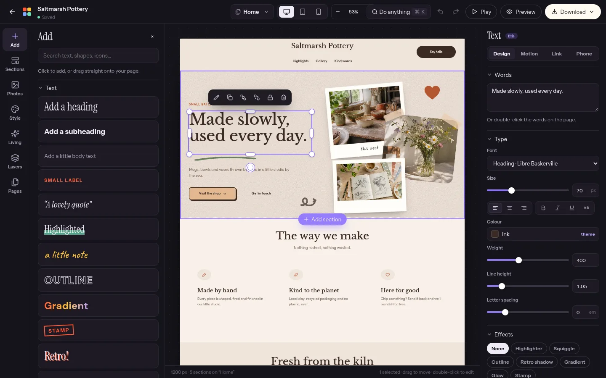

# Quilt: the site maker engine

Quilt is Patchwork's website builder (`/?quilt`). It feels like a design tool: drag anything anywhere, resize, rotate, layer. But the output is a real, responsive, multi-page website. This page explains how it works and how to extend it. Read it before you change anything in `src/quilt/`.

## The idea in one paragraph

Every section is a **grid of 96 columns by 8 px rows** (1200 design px wide). An element's position is a frame on that grid (`x, y, w, h` in columns and rows, plus rotation). The renderer turns frames into `grid-area`, so the free canvas *is* a CSS grid. Rows are `minmax(8px·scale, auto)`, so text that gets longer pushes things down instead of overlapping. All sizes use container-query units against `.q-site`, so the editor's device frames behave exactly like real screens. Phones get a computed **smart stack**: one column, in the order a person reads the desktop layout.

## Files

| File | Job |
|---|---|
| `model.ts` | The document: `QuiltDoc → pages → sections → elements`. The only shapes anything reads or writes. |
| `validate.ts` | Everything from outside (imports, IndexedDB) goes through `validateDoc`. Repairs bad values, throws on wrong structure. |
| `theme.ts` | Fonts (bundled files only), 16 style kits, colour tokens (`$accent`…), contrast helpers, "palette from one colour". |
| `layout.ts` | Card nesting by containment, phone reading order (XY-cut), snapping. Pure functions, unit-tested. |
| `render.ts` | Document → CSS + HTML. Used by the canvas, the preview and the export. **One renderer.** |
| `site-css.ts` | The base stylesheet every site ships (grid, phone stack, buttons, masks, widgets, motion). |
| `runtime.ts` | ~3 KB script shipped with sites: entrances, parallax, countdowns, count-up numbers, forms, cursor trail. |
| `pieces.ts` | Patchwork heroes (all 23) and scenes (16) as whole sections, with the person's words in them. |
| `widgets.ts` | Working parts (menu, countdown, ticker, FAQ, form, social, list, numbers, video). Each declares fields; the inspector builds its own controls. |
| `ops.ts` | Pure document operations (move, restack, align, distribute, add/duplicate/move sections, pages, kits). |
| `export.ts` | The website zip (one HTML per page + everything it uses) and the editable project bundle. |
| `storage.ts` | IndexedDB `patchwork-quilt`: `sites` and `assets` (uploads, referenced as `asset:<uuid>`). |
| `library/recipes.ts` | Section recipes: kinds × layouts, built from content with **slots**. Rearrange lives here. |
| `library/templates.ts` | Whole-site templates and `newSite()` (also what Quick start calls). |
| `library/shapes.ts`, `icons.ts`, `seams.ts`, `media.ts`, `build.ts` | Shapes and doodles (CSS masks), line icons, seams and patterns, stock photos and living pieces, element constructors. |
| `editor/` | The React editor: `QuiltApp` (front door + routing + saving), `Editor` (shell, history, keys), `Canvas` (direct manipulation), `panels.tsx` (left), `Inspector.tsx` (right), `CommandBar`, `Preview`, `controls.tsx`, `quilt.css`. |

## Things that must stay true

- **One renderer.** The canvas renders element wrappers in React but takes their insides from `elementInner()`, and all styling comes from `siteCss()` + `pageCss()`. If you add a visual feature, add it to the renderer and it appears everywhere. Never style site content from `quilt.css`.
- **Tokens, not colours.** Recipes and templates use `$bg`, `$ink`, `$accent`… so Shuffle and the style kits restyle everything. Use hex only for things that must not change (white text on a photo).
- **Old documents keep opening.** New fields are optional with a renderer default, and `validate.ts` learns them. Don't bump `version` unless you write a migration.
- **No network in exports.** Fonts come from `theme.ts`'s bundled list, pictures from uploads or `/quilt/stock`. `tests/quilt.test.ts` checks the CSS and runtime.
- **Escape what people type.** Text goes through `esc`/`escLines`, links through `href()`/`safeUrl()`. Picture sources must pass `isSrc()`.
- **Slots are a contract.** In a recipe, every layout must place the same slots (`title`, `body`, `cta`, `i0-title`…). The round-trip test walks every layout and fails if one drops content.

## Heroes and scenes as sections (pieces)

A section can carry a `piece`: one of the collection's heroes (`hero` for Hero Sections II, `classic` for the original five) or a scene. `pieces.ts` builds the piece's own complete page with the section's words (`hero2Document`, `heroDocument`, `sceneDocument`), so it looks and runs exactly as designed in its collection. The renderer shows it as an iframe in the section's background layer, so Quilt elements can still be placed on top.

The piece page gets two small injections:
- `hideNav` hides its own menu, for sites with a shared header. It's on by default when the site has one.
- A click relay: links inside the piece post `{ quiltLink }` to the site. The main button's real target (`piece.link`, resolved with `href()`) replaces the `#quilt-cta` placeholder. The site runtime only accepts messages from its own `iframe.q-piece` frames and only follows `#anchors`, `*.html` pages, `https:`, `mailto:` and `tel:`.

| | Editor and preview | Download |
|---|---|---|
| Piece page | blob URL per section (`pieceUrl` in `Editor.tsx`), rebuilt 450 ms after typing stops | `living/piece-<section id>.html` |
| Its files | served from `/heroes2/`, `/heroes/`, `/scenes/` | copied to the same folders (`pieceFiles`) |

Thumbnails that can't run live (dashboard cards) show the piece's palette, or its painting or cover when it has one. The Sections panel's cards run live but only while on screen, because browsers allow a limited number of WebGL pages at once.

**Adding a hero or scene to its collection** makes it available in Quilt automatically, as long as its catalog entry, `…Document` and `…Files` are complete. `tests/quilt.test.ts` checks that every piece builds and that every file it needs exists.

## Phones

`layout.ts` does it, and `render.ts` writes it as `@container q (max-width: 640px)` rules:

1. **Cards.** A box-like shape (rect, pill, blob, arch, hexagon) that sits behind other elements and fully contains them becomes their parent. On desktop the card is a CSS **subgrid**, so nothing moves. On phones the card is a padded flex box and everything on it travels with it. People never have to group anything.
2. **Reading order.** `readingOrder()` is a recursive XY-cut: make one cut at the widest empty gutter (horizontal or vertical), read each side, repeat. A full-width title is cut off first, columns of cards beat the rows inside them, and a price list reads row by row. The result becomes CSS `order`.
3. **Sizes.** Text uses `max(phonePx, size × --u)`. `phoneSize()` shrinks big type more than body copy. Pictures keep their desktop aspect ratio. Decorative shapes *float* (absolute, kept near their top or bottom edge).
4. **Overrides** live in `el.phone` (hide, order, float, text scale) and `section.phone` (padding, gap, alignment). The inspector's Phone tab edits them.

## Adding things

**A section layout:** add a `Layout` to the right recipe in `library/recipes.ts`. Use the same slot names as its siblings, and use tokens. Run `npm test`; the round-trip test checks the slots. It appears in the Sections panel, the command bar and Rearrange automatically.

**A new kind of section:** add a `Recipe` with `sample` content and at least one layout.

**A widget:** add the kind to `WidgetKind` in `model.ts`, then an entry in `WIDGETS` (defaults, `fields`, `render`). If it needs behaviour, add a few lines to `runtime.ts`. The Add panel, inspector and validation pick it up.

**A style kit:** add to `KITS` in `theme.ts`. Fonts must be from `FONTS`.

**A font:** add the file under `public/`, its OFL licence, and a `FONTS` entry. The test checks both files exist.

**A shape:** add a `ShapeDef` to `library/shapes.ts` (black SVG; it's used as a mask). Shapes in `BOXES` (`layout.ts`) can become cards.

**A seam or pattern:** `library/seams.ts`. Seams are masks on the section's bottom edge; the section overlaps the next one by the seam's depth.

**A template:** add to `TEMPLATES` in `library/templates.ts`. Build pages from recipes, and give it a `for` line (Quick start shows it as a choice).

**An editor action:** write it as a pure function in `ops.ts`, call it through `q.commit()` (undoable). Add a command to `CommandBar.tsx` so it is searchable.

## The editor in short

- State lives in `Editor.tsx` and reaches everything through `useQuilt()` (`editor/context.ts`).
- `commit(doc, mergeKey?)` records undo. Changes with the same `mergeKey` within about a second merge, so a slider drag is one step. Drags use `begin()` / `transient()` / `end()`.
- `Canvas.tsx` measures the rendered DOM for every box it draws (selection, hover, section bars), so it stays correct whatever CSS does. Pointer maths uses `designScale(width, zoom)`.
- Text is edited in place with `contenteditable="plaintext-only"` on the `.q-tx` span and committed on blur.
- Living scenes in the editor and preview are blob URLs of `sceneDocument(id, { text: false })`. In a download they become `living/<id>.html` beside the scene files.
- Residents (`<pw-pal>`) draw on the spirits kit's shared fixed canvas; `quilt.css` clips it to the canvas area.

## Not built yet (good next steps)

- A phone layout you can drag freely, with its own frames per element (today: order, hide, float and sizes).
- Rich text inside one text box (bold one word). Today styles apply to the whole box.
- Groups you make yourself (today cards group automatically).
- Real multi-user editing. Every change is already a pure function over an immutable document, so this would slot in at `commit`.
- More layouts per recipe, more recipes (team, timeline, logos, blog list), and blog/collection pages.
- Using the Specimen hero's "your own picture" and the scenes' photo option inside Quilt (the config field exists in the collections, but Quilt doesn't expose it yet).
- Importing a classic Patchwork project (`src/types.ts` `Project`) into Quilt.
