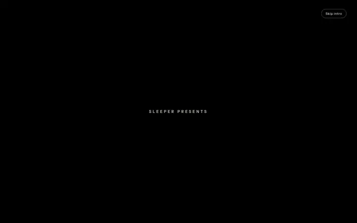

# Title cards: a headline painted into the picture

> Engine · `public/scenes/titlecard.js`, on top of [Diorama](diorama.md)'s title plane. Used by the Hayfield, Blue Room and Night Train scenes.



A title card treats the page's headline as a film title that lives **inside** the scene rather than being laid over it. The words hang at a real depth. When you look around, anything nearer than that depth (an oak branch, a jellyfish, a signal post) passes in front of the letters, and the letters cast a soft shadow on whatever is behind them.

## How it works

1. **Lettering.** `titlecard.js` reads the page's own words (`.sx-eyebrow`, `.sx-title`, `.sx-brand`). It sets them on a transparent canvas the same size as the painting (1672 × 941): a kicker in spaced pixel capitals, the title in Instrument Serif italic, and an "a … picture" credit under a short rule.
2. **Fitting.** The title is broken into one to three balanced lines. It takes the largest size that fits both the card's width and its height budget, with a small penalty for every extra line. The card is kept below the navigation bar.
3. **Depth.** `diorama.setTitle(canvas)` uploads the lettering as a texture. In the scene shader, the ray from the camera is marched against the painting's depth map. The title is drawn only where the ray reaches the title's depth before it hits the painting (`behind = smoothstep(-.012, .012, titleDepth - surfaceDepth)`). A blurred mip level of the same texture, offset down and to the right, darkens what lies behind the letters. The title also writes into the glow buffer, so it blooms (`title.glow`), and it picks up fog for its depth.
4. **Opening.** The sequence runs: black, then "*Brand* presents" with tracking that closes up, then the picture fades up while the camera pushes in (`cam.zoom` 1.14 → 1), then the letterbox bars open, then the kicker, the title (written on left to right through a soft wipe) and the credit arrive. The page's navigation, copy and buttons wait until the card is finished.
5. **Phones.** Only a narrow middle strip of the painting is on screen, so the card re-centres, the title wraps to more lines, and the small lines move out of the picture into the page as real text, because at that size they would be a few pixels tall.

## Using it in a scene

```js
const d = DioramaScene({
  // …the usual Diorama options…
  title: { depth: .32, glow: .25, shadow: .35 },   // where the plane hangs (0 far … 1 near)
  action: "Play the titles", onAction: () => card?.play(),
});
const card = TitleCard(d, {
  box: [.42, .33, .6, .26],    // centre x, centre y, width, height budget — in painting fractions
  phoneY: .2,                  // centre y when only the middle strip is visible
  color: "#fff2da", ink: "rgba(90,40,60,.45)",   // letters, and the soft edge under them
  push: 1.16,                  // starting zoom of the push-in
});
```

Choosing the depth: open the depth map. The title should sit just in front of the background it reads against and behind one or two foreground things that can cross it. That crossing is the effect, so compose the painting for it: ask for open sky or open water where the title goes and something near the camera reaching into that space.

## Behaviour

- **Skippable.** There is a *Skip intro* button, and Esc also skips. *Play the titles* replays the card.
- **Not every time.** Previews (the page is framed) and repeat visits in the same session start on the finished card.
- **Reduced motion** shows the finished card with no push-in.
- **Words stay words.** The `<h1>` and the kicker remain in the page for search engines and screen readers. Only their visible copy is painted. With the scene's words switched off, no card is drawn.
