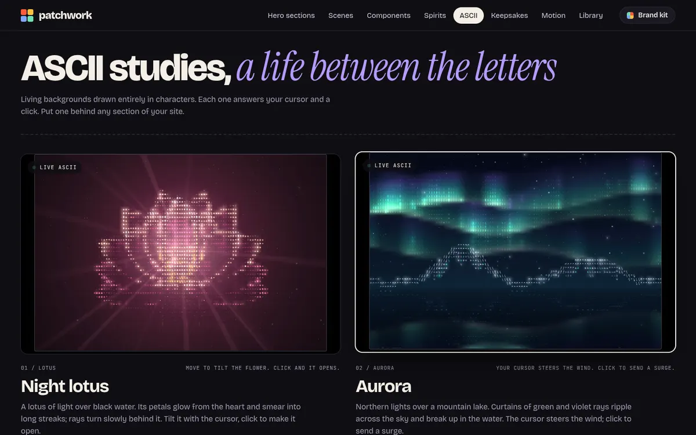

# ASCII: a life between the letters

> `src/AsciiGallery.tsx`, `src/AsciiPage.tsx`, `src/PaintStudio.tsx` · scenes in `src/ascii/` · open with `/?collection=ascii` · engine notes in [ASCII](../engines/ascii.md)

Living backgrounds drawn entirely in characters. Each one answers your cursor and a click, and any of them can sit behind a section of a site made in the studio.

| Scene | What happens |
|---|---|
| **Night lotus** | A lotus of light over black water. Its petals glow from the heart and smear into long streaks while rays turn slowly behind it. Tilt it with the cursor; click and it opens. |
| **Aurora** | Northern lights over a mountain lake. Curtains of green and violet ripple across the sky and break up in the water. The cursor steers the wind; a click sends a surge. |
| **Neon rain** | A city street at night: humming neon signs, windows switching on and off, slanting rain and a wet street full of reflections. Your cursor carries an umbrella; a click brings lightning. |
| **Koi pond** | A garden pond from above: patterned koi glide under lily pads while light ripples over the floor. Drag ripples through the water; click to drop food and they come for it. |
| **Your painting** | Paint something in the paint studio, or start from a photo or a starter picture, and it becomes living characters. |

With **Living site** switched on in the studio, every scene follows the visitor's own clock.
