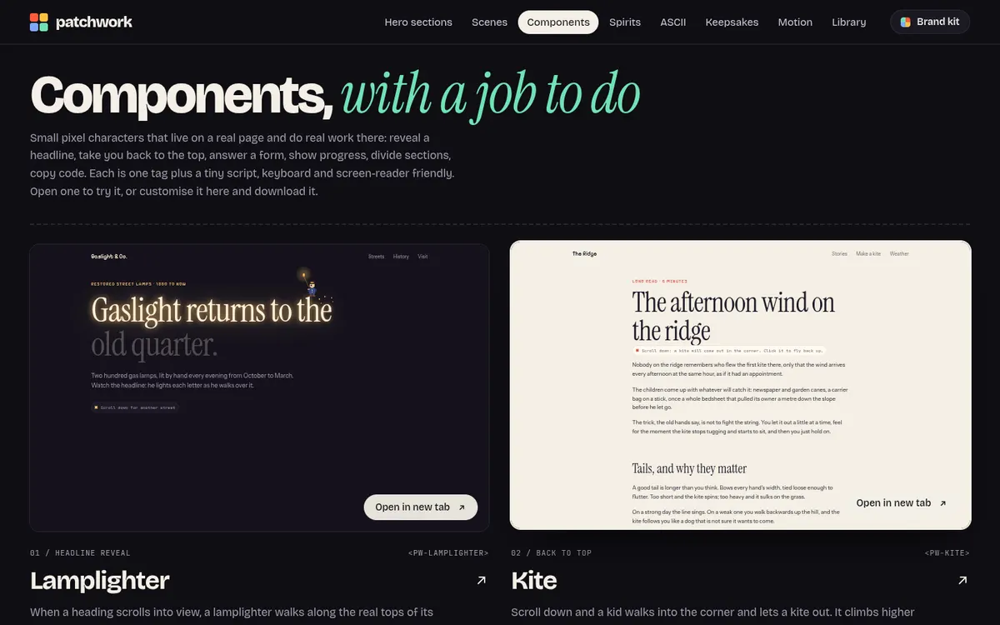
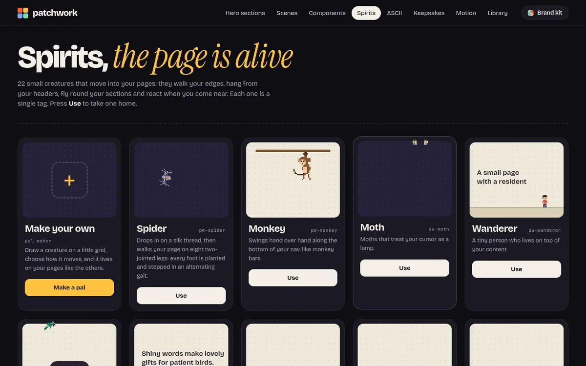

# Components and Spirits: the page is alive

> `src/components/`, `src/spirits/` (catalog, document, gallery, route; `maker.ts` for pals) · pieces in `public/components/*.js` and `public/spirits/*.js` · open with `/?component=<id>` or `/?spirit=<id>` · engine notes in [creature kit](../engines/creatures.md)

<p>
  
  
</p>

Both collections are little pixel characters packaged as custom elements. You paste a `<script>` and a tag into any website, with no framework and no build.

- **Components have a job.** A headline reveal (Lamplighter), a back-to-top (Kite), a form helper (Postie), a progress bar (Cocoon), a divider (Tightrope) and a copy-code button (Mimeo). Each wraps or sits beside a real element, so it still works for keyboards and screen readers. The character is the delight on top.
- **Spirits just live there.** 22 creatures that walk your edges, hang from your headers, fly around your sections and react when you come near: a spider on silk, a monkey on the monkey bars, a moth that circles your cursor, a hummingbird, a magpie, a hedgehog, a fox, a ghost, an octopus…
- **Make your own pal.** Draw a creature on a small grid, choose how it moves (walk, hop, crawl, fly, hang, sit) and how it reacts, and get a working `<pw-pal>`.

## Using one

```html
<script src="kit.js" defer></script>
<script src="kite.js" defer></script>
<pw-kite color="#ff5b3a"></pw-kite>
```

The gallery writes this snippet for you with the options you chose, and the download includes `kit.js`, the creature, its demo page, fonts and licences.
