# Hero sections: make an entrance

> `src/heroes2/` (catalog, document, gallery, route) · pieces in `public/heroes2/<id>/hero.css|hero.js` · the five originals in `src/heroes/` · open one with `/?hero2=<id>`

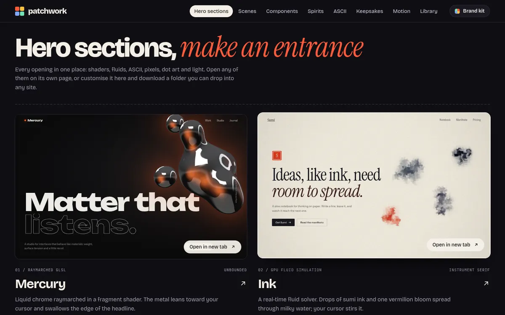

Twenty-three single-screen openings. Each is built a different way, with its own typeface and palette. Every one opens on its own page, takes your words and downloads as a folder.

| | Hero | How it's made |
|---|---|---|
| 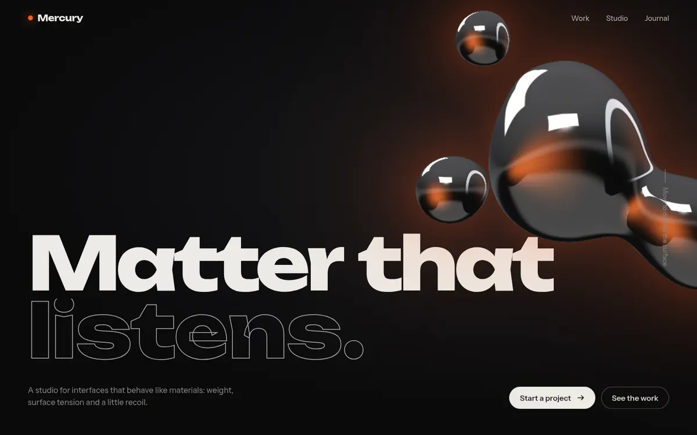 | **Mercury** | Liquid chrome raymarched in a fragment shader; it leans toward the cursor and swallows the edge of the headline. |
| 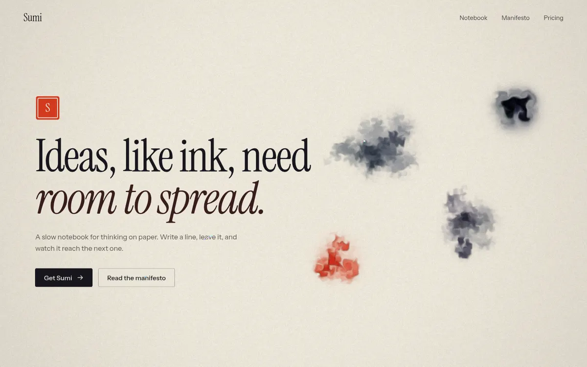 | **Ink** | A real-time GPU fluid solver: sumi ink and one vermilion bloom spreading through milky water. |
| 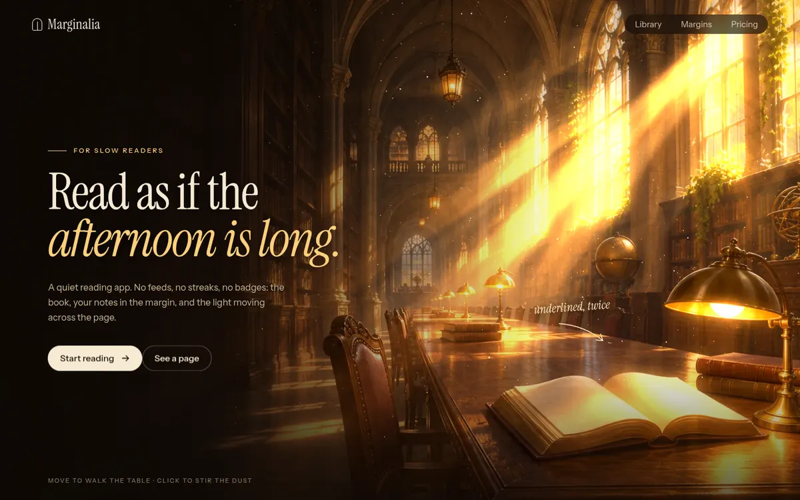 | **Reading Room** · Forge · Tea House | Generated paintings rendered in depth by [Diorama](../engines/diorama.md): walk the table, work the bellows, steep the tea. |
| 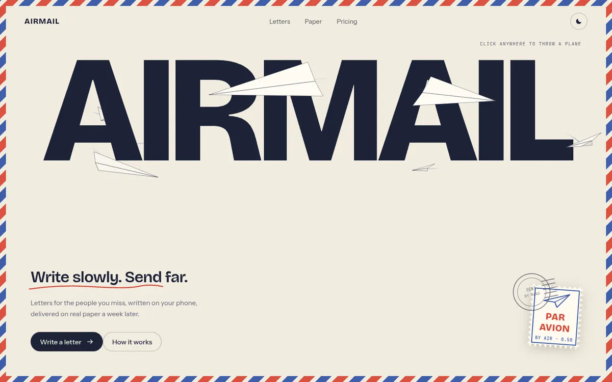 | **Airmail** | Hand-built 3D paper planes that loop behind and in front of the word. |
| 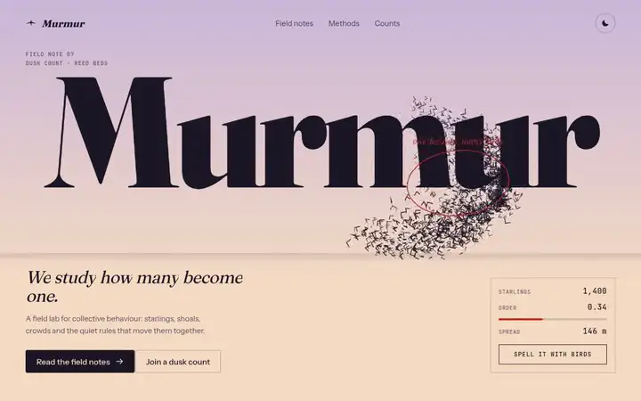 | **Murmuration** | 1,400 birds in a 3D flock on a spatial grid. They flow through the word, and *Spell it with birds* makes them write it. |
| 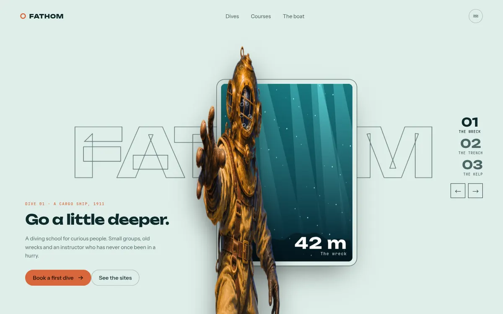 | **Deep** | A diver cut-out stepping out of a tilting 3D card with a live painted sea. |
| 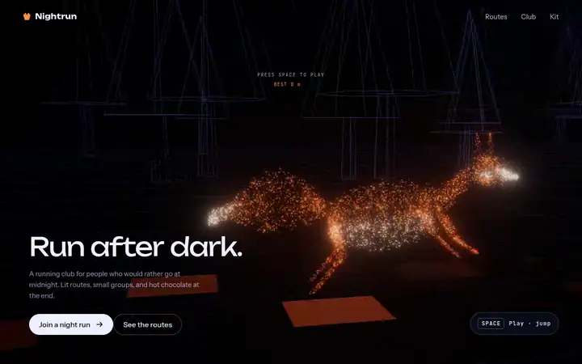 | **Night Run** | A 5,200-particle fox in a wireframe forest that turns into a game. See [particles](../engines/particles.md). |
| 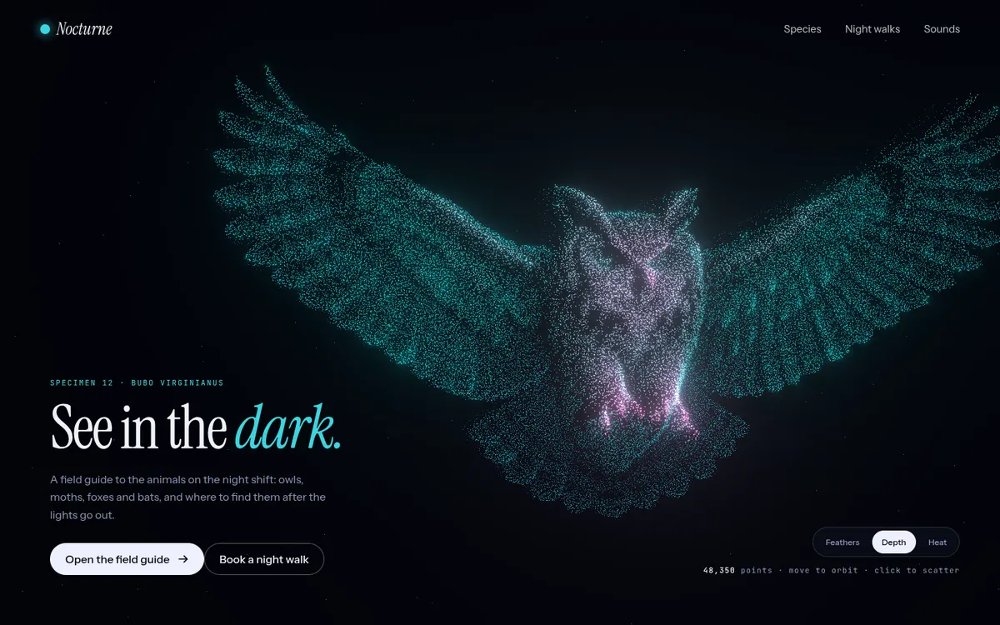 | **Nocturne** | An owl rebuilt from a painting and its depth map as about 48,000 points with a shader wing-beat. |
| 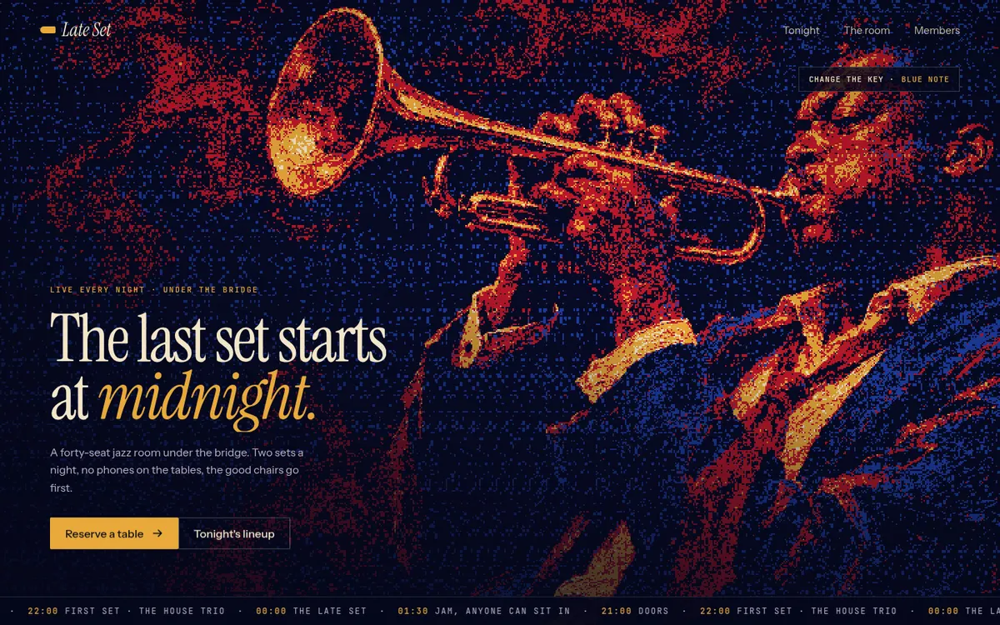 | **Late Set** | A stop-motion "boil": two painted frames posterised to five inks in a WebGL shader, with per-drawing wobble and grain. |
| 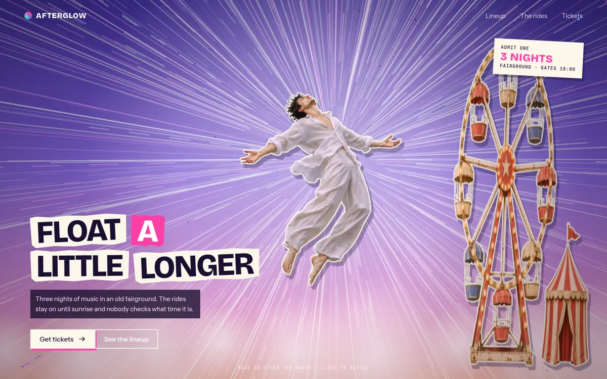 | **Afterglow** | A collage: a radial glitch burst, keyed paper cut-outs, film damage at 12 fps and an RGB split on click. |
| 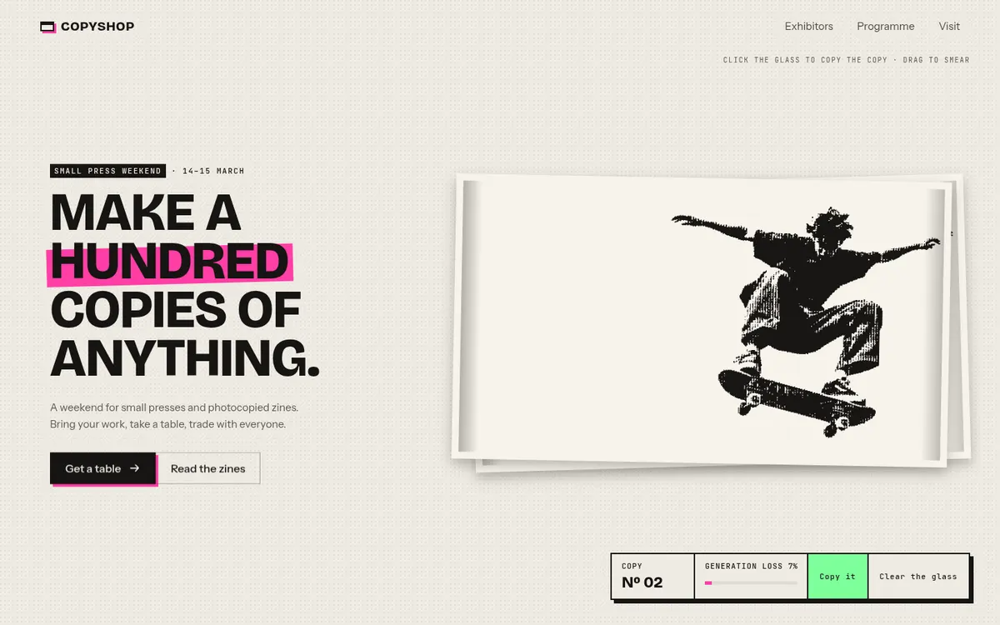 | **Copyshop** | Photocopier generation loss. Every copy degrades a little more, they pile up, and you can drag to smear the top one. |

Also in the collection: Paper Terminal (a globe drawn in ASCII), Lowtide, Breath, Specimen and Prism, and the five originals (Facet, Undertow, Daybreak, Lattice, Frequency) from the first hero studio.

## Anatomy of a hero

- `src/heroes2/catalog.ts`: id, name, technique, typeface, description, palette, fonts and default words.
- `src/heroes2/document.ts`: the markup function for the hero, the complete standalone page, and `hero2Files`, the list a download needs.
- `public/heroes2/<id>/hero.css` and `hero.js`: the piece itself, plain files with no build step. The three.js heroes are the exception and are bundled by `npm run build:particles`.
- The id must also be in `src/heroes2/route.ts`, or `/?hero2=<id>` won't open.

Every hero has a day/night switch, answers the pointer, pauses offscreen, and has a still state for reduced motion.
