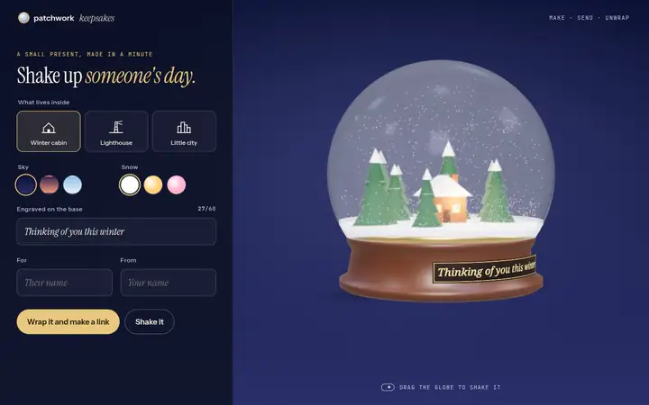

# Keepsakes: make, send, open

> `src/keepsake/` (`globe.ts`, `data.ts`, `entry.ts`, `route.ts`, `keepsake.css`) · open with `/?keepsake=globe`

  

A small present, made in a minute. Build a snow globe, send it as a link, and the person who opens the link unwraps it.

1. **Make.** Choose what lives inside (a winter cabin, a lighthouse or a little city), the sky (night, dusk or day), the snow (white, gold or rose), an engraving for the plaque, and who it's for and from.
2. **Send.** *Wrap it and make a link* puts the whole globe into the link itself: a base64url JSON blob in `#g=`. Nothing is uploaded, and there is no server or account.
3. **Open.** The receiver sees a wrapped gift box. Scrolling lifts the lid and the globe rises out. Drag the globe to shake it.

## How it's built (`globe.ts`)

Everything is built from code in three.js:

- a glass dome with physical transmission;
- a turned wooden base (a lathe) with a brass ring and an engraved plaque;
- the small world inside;
- snow simulated flake by flake. Flakes drift, swirl and settle on the ground, then lift again when the globe is shaken.

The glass doesn't write depth, and the snow renders after it, so flakes stay visible through the glass.

`data.ts` normalises everything that arrives in a link. The code must look like base64url and be at most 1,200 characters. Unknown worlds, skies and snows fall back to defaults. Text loses control characters and is capped (60 characters for the engraving, 30 for the names). A tampered link can't inject anything.
