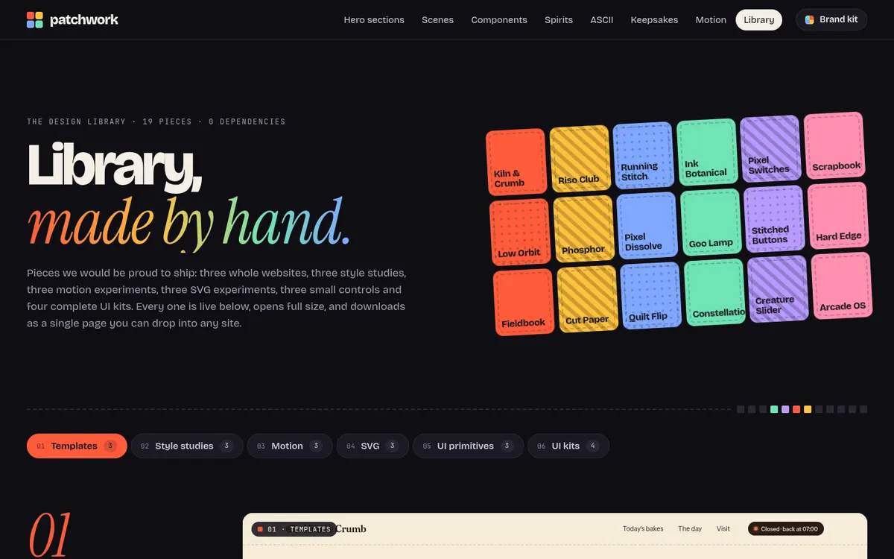
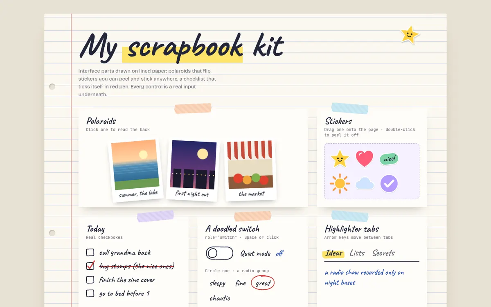
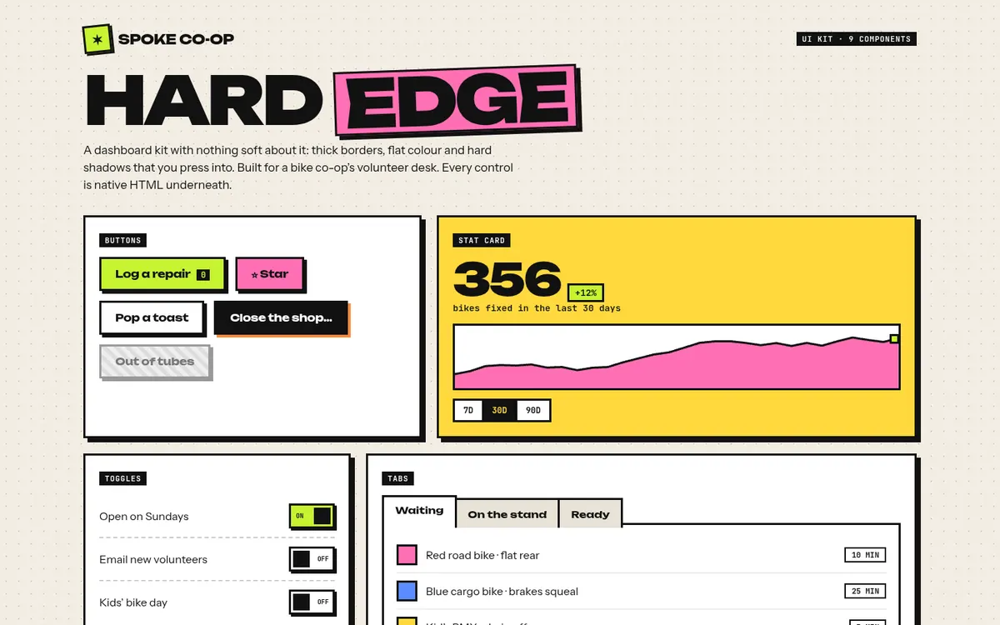
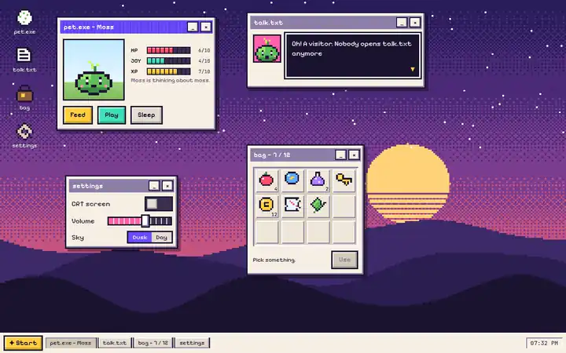
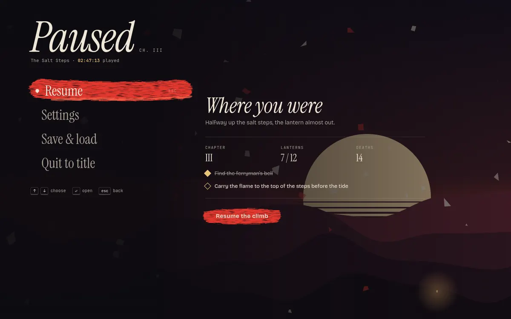

# The Design Library: made by hand

> `src/DesignLibrary.tsx`, `src/library/catalog.ts`, `src/library/export.ts` · pieces in `public/library/<id>/index.html` · shared `public/library/fonts/` and `licenses/`

Nineteen pieces on six shelves, each a **single self-contained page**: HTML, CSS and a little JavaScript, with no dependencies and no network requests. Open one full size, or download it as a folder with its fonts and OFL licences.

| Shelf | Pieces |
|---|---|
| Templates | Kiln & Crumb (a bakery at dawn), Low Orbit (a podcast), Fieldbook (a botanist's notebook) |
| Style studies | Riso Club, Phosphor, Cut Paper |
| Motion | Running Stitch, Pixel Dissolve, Quilt Flip |
| SVG | Ink Botanical, Goo Lamp, Constellations |
| UI primitives | Pixel Switches, Stitched Buttons, Creature Slider |
| **UI kits** | Scrapbook, Hard Edge, Arcade OS, Pause |

## The UI kits

Each kit is a complete set of working components in one visual language. Every control is a real input underneath (checkbox, range, switch, tablist, radiogroup, `<dialog>`, `
`), so they all work with a keyboard and a screen reader.

  
  

  
  

- **Scrapbook**: lined paper, polaroids that flip, stickers you peel off a sheet and stick anywhere, a checklist ticked in red pen, a doodled switch, highlighter tabs, a tape progress bar and a sticky note.
- **Hard Edge**: a brutalist dashboard for a bike co-op. Buttons press flat, and there is a sparkline stat card, toggles, checkbox chips, toasts, an accordion and a type-to-confirm dialog.
- **Arcade OS**: a pixel desktop. Windows drag by their title bars (or move with the arrow keys) and minimise to a taskbar. There is a typewriter dialogue and a bag with tooltips. Feed Moss the slime until it levels up and breaks out of its window.
- **Pause**: a game's pause menu in red ink. The arrow keys move a brush stroke, Enter opens a panel and Esc resumes the painted world behind it. Save slots stamp when you save.

## Adding a piece

Write `public/library/<id>/index.html` using only `../fonts/` for fonts, then add an entry to `src/library/catalog.ts`. `tests/library.test.ts` checks that every piece has a title and a viewport, makes no remote requests, and that every font it uses ships with its licence.
