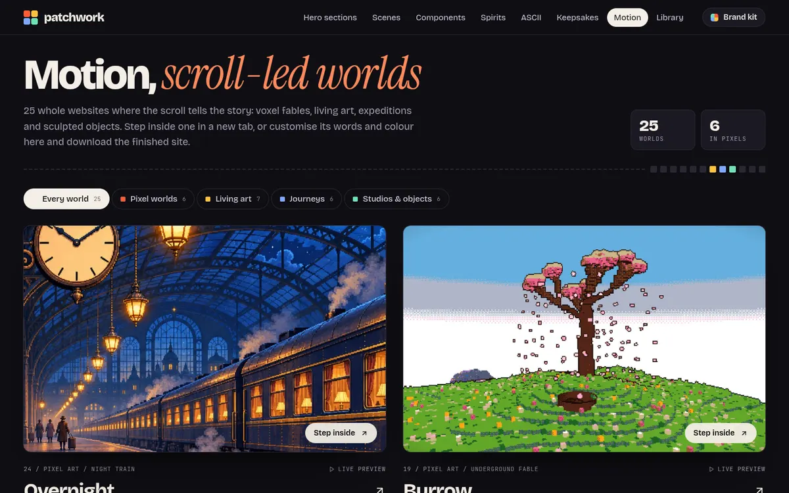
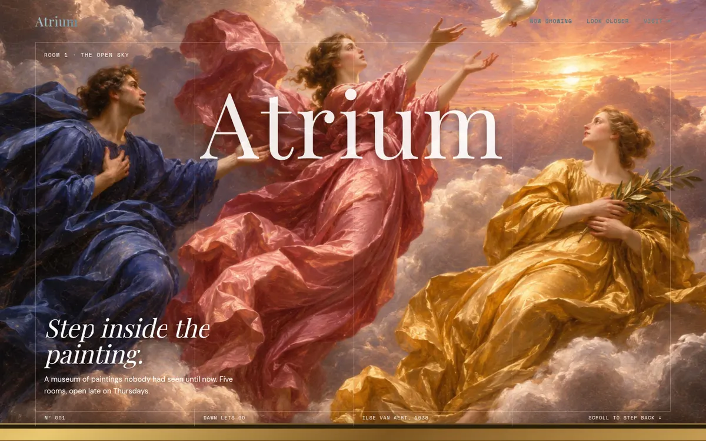
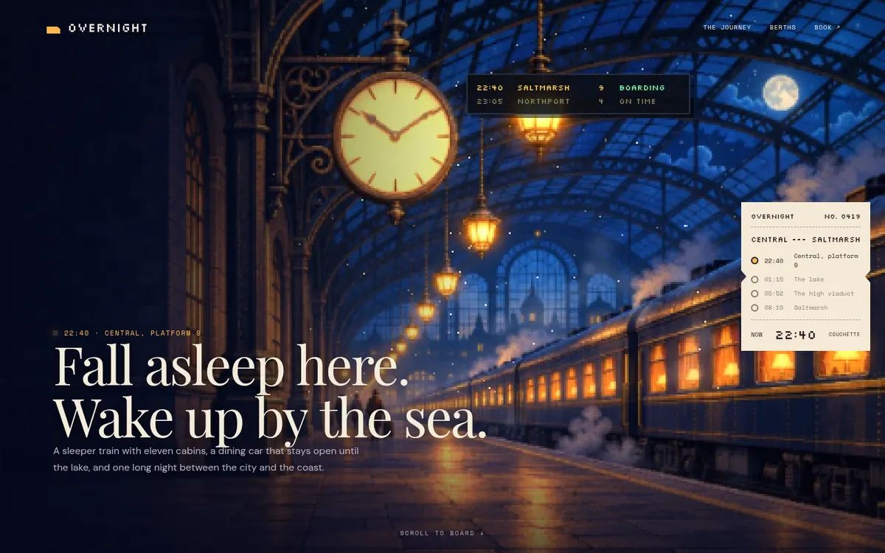
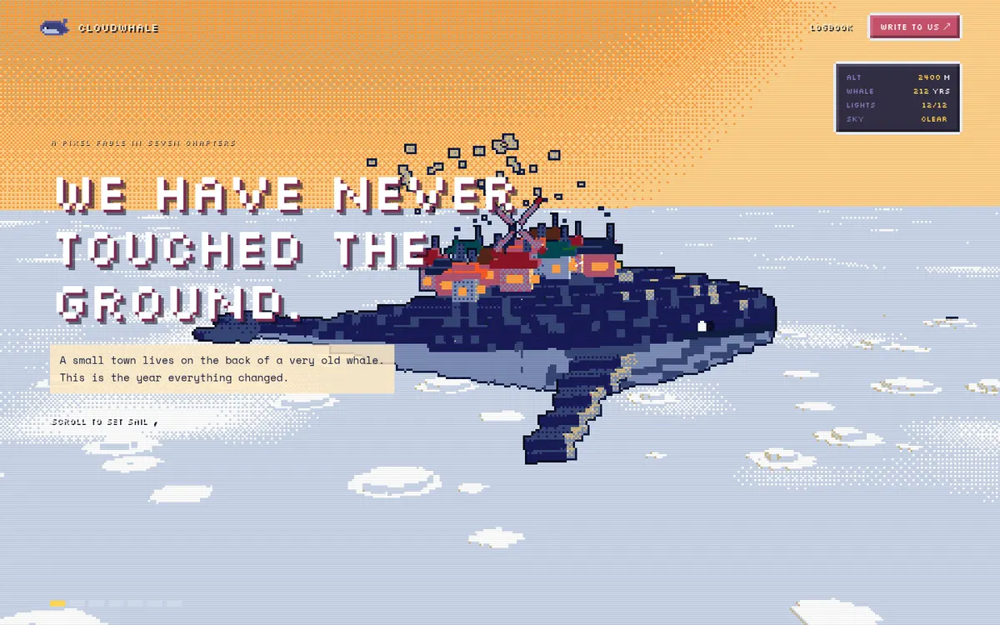
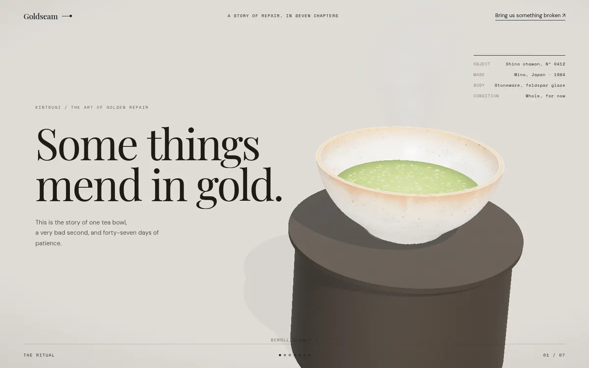

# Motion: scroll-led worlds

> `src/motion/` · bundled to `public/motion/engine.js` · open one with `/?view=motion&motion=<id>` · engine notes in [motion runtime](../engines/motion.md)

Twenty-five whole websites whose story is told by scrolling: 3D objects that come apart and reassemble, illustrated fables, living specimens, pixel worlds and painted ones. Each opens on its own page, takes your brand, headline and email, and downloads as a folder.

  
  

  
  

## Highlights

- **Atrium**: the website of an imagined museum, where the paintings are the interface. You start inside a painting and scroll back until it hangs on the wall. Then a sideways walk where frames turn toward you, a loupe for the brushwork, four details to zoom into with guide notes, and a ticket desk with a running total. The five paintings are new and the artists are fictional.
- **Overnight**: one night on a sleeper train in four pixel paintings rendered in depth, with a ticket that is punched at every stop.
- **Cloudwhale**: a small town on the back of a very old whale, in pixels.
- **Goldseam**: a story of repair in seven chapters: one tea bowl, a very bad second, and forty-seven days of patience.
- **Burrow**, **The Last Lightkeeper**, **Mosslight**, **Æther**, **Monolith**, **Bitquest** and more.

## Mosslight, the reusable one

Mosslight's living pixel horizon is also packaged as a standalone custom element, `<mosslight-bg>`, in `public/motion/mosslight/`. See its [README](../../public/motion/mosslight/README.md).
