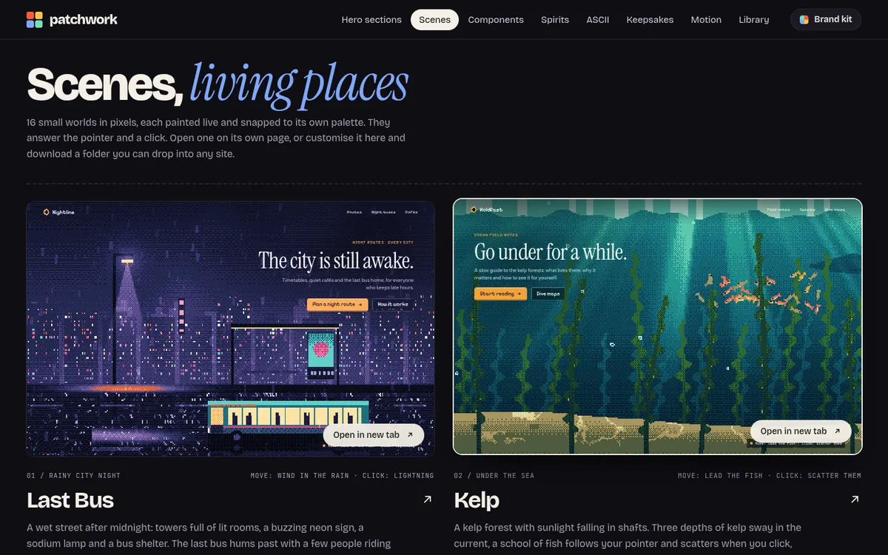
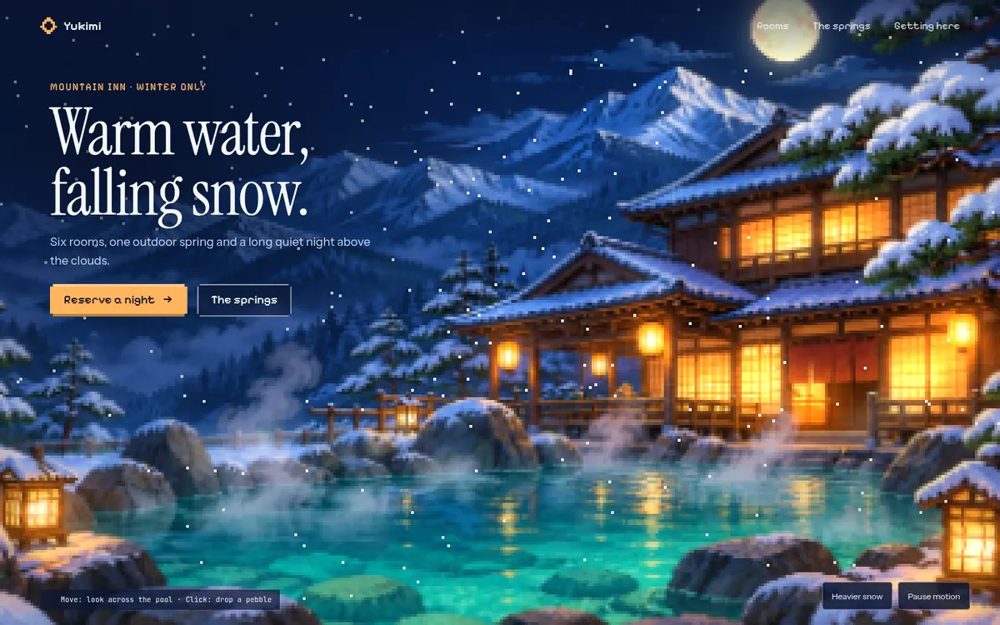
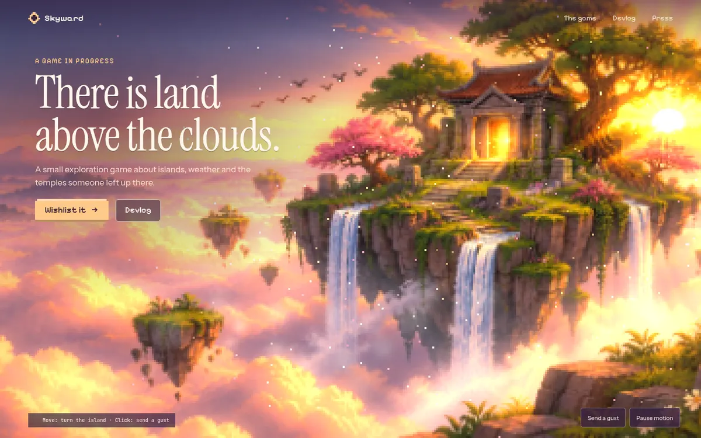
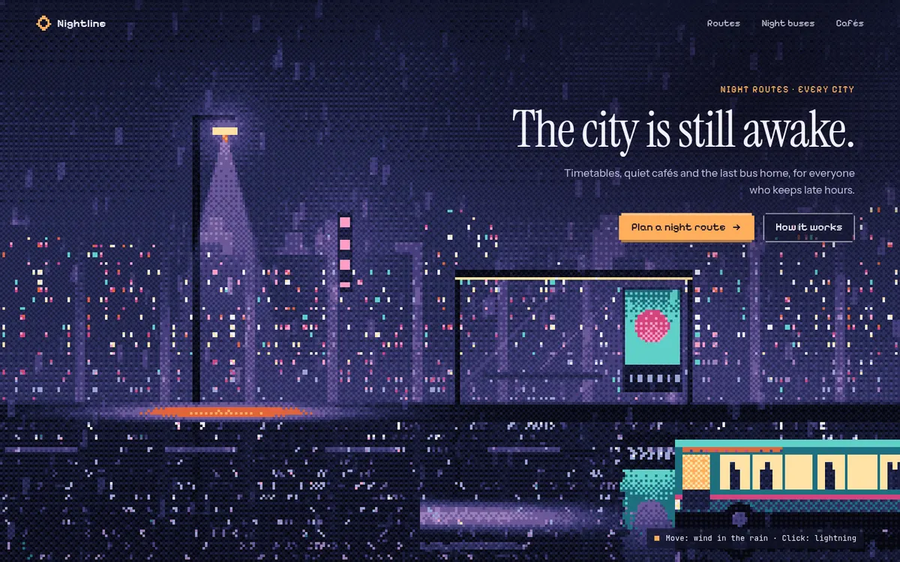
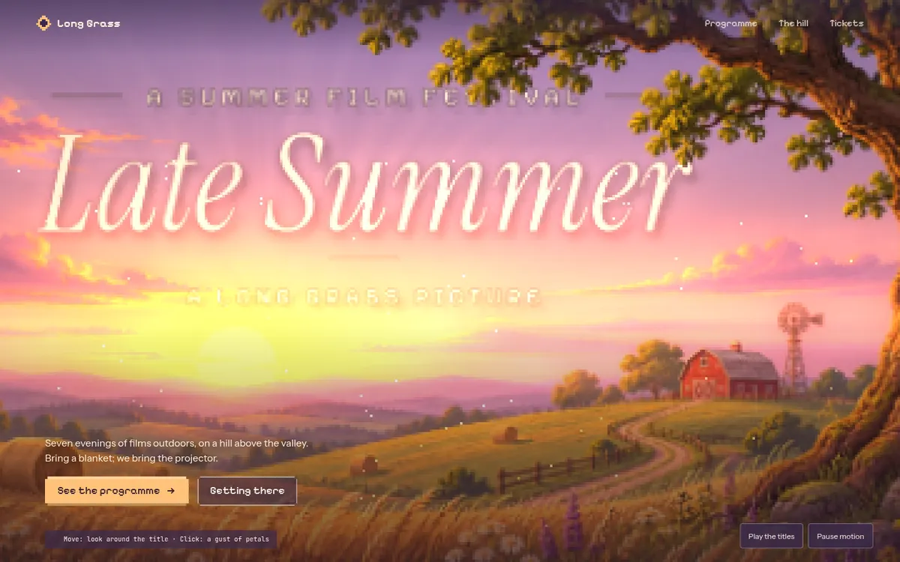
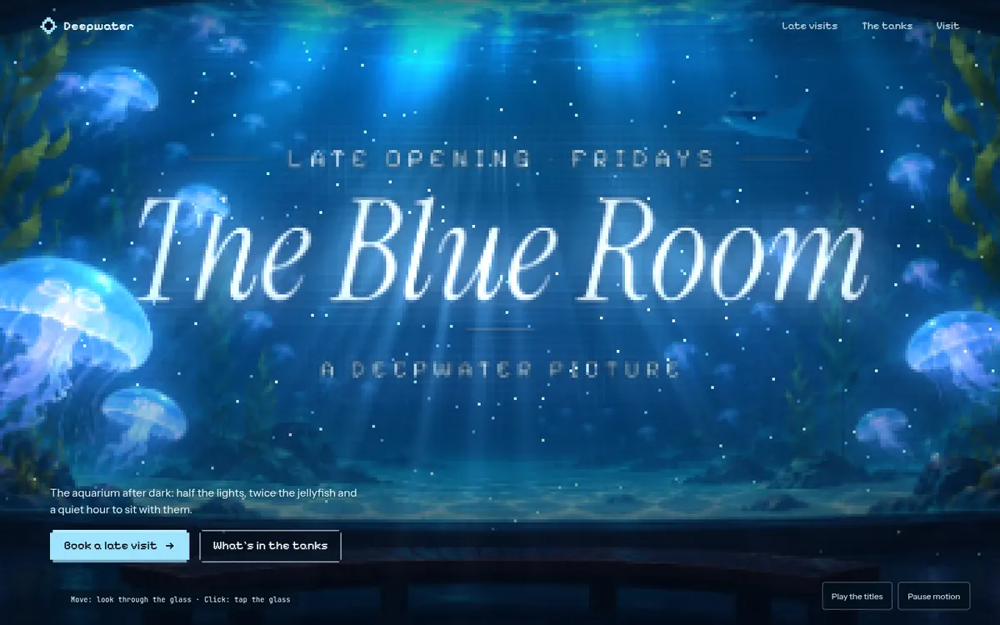
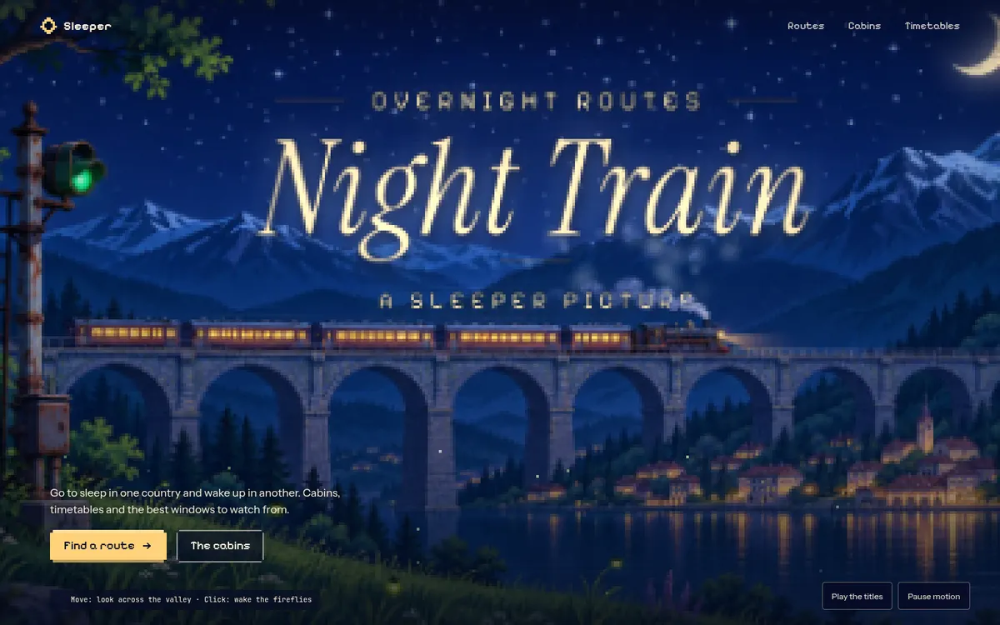

# Scenes: living places behind a headline

> `src/scenes/` · pieces in `public/scenes/<id>/scene.js` · shared `base.css`, `pixel.js`, `diorama-scene.js`, `titlecard.js` · open one with `/?scene=<id>`

Sixteen full-screen places in pixels, each one a background for a headline and two buttons. They all answer the pointer and a click, take your words, can paint an uploaded photo in their own colours, and download as a folder.

## Three kinds

| Kind | Engine | Scenes |
|---|---|---|
| **Procedural** | [`pixel.js`](../engines/pixel-scenes.md): one fragment shader snapped to a 16-colour palette | Last Bus, Kelp, Long Night, Rooftops, Riso Swell, Lantern River, Tidewatch, Cloudline, Glasshouse, Pomegranate Court |
| **Painted** | [Diorama](../engines/diorama.md): a generated pixel painting and its depth map | Onsen, Arcade, Sky Isle |
| **Title cards** | Diorama's title plane + [`titlecard.js`](../engines/title-cards.md) | Hayfield, Blue Room, Night Train |

  
  
  

  
  
  

## The page

`src/scenes/document.ts` builds every scene's page from the same template: a nav bar with a small pixel mark, the copy block in the scene's chosen layout (`top-left`, `top-right`, `middle-left`, `top-center`, `riso` or `titlecard`), the canvas, a soft scrim, an interaction hint, and the scripts. Options (`normalizeScene`) are brand, eyebrow, headline, sub, two buttons, a link, a pixel size (3–6), words on or off, and an optional photo.

Words switched off turns a scene into a plain background, but an accessible `<h1>` stays.

## Adding one

1. Pick the kind. For a painted one, follow the recipe in [Diorama](../engines/diorama.md#making-a-new-painted-piece). For a title card, compose the painting so something near the camera reaches into the space where the title will hang.
2. `public/scenes/<id>/scene.js`, an entry in `catalog.ts` (with `engine: "diorama"` and/or `layout: "titlecard"`), the id in `route.ts`, nav links in `document.ts`, and colour tokens in `base.css`.
3. `tests/scenes.test.ts` checks that every scene is a complete page with all its files, reacts to the pointer and a click, and makes no external requests.
