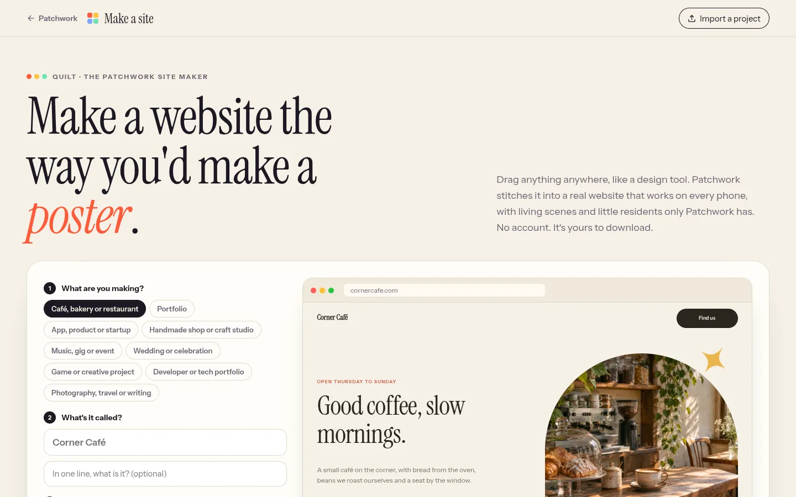
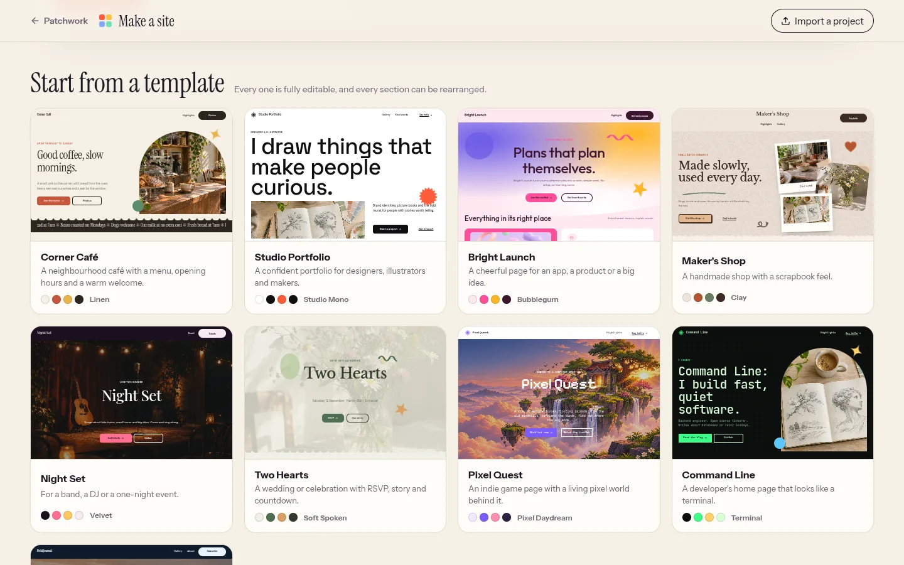
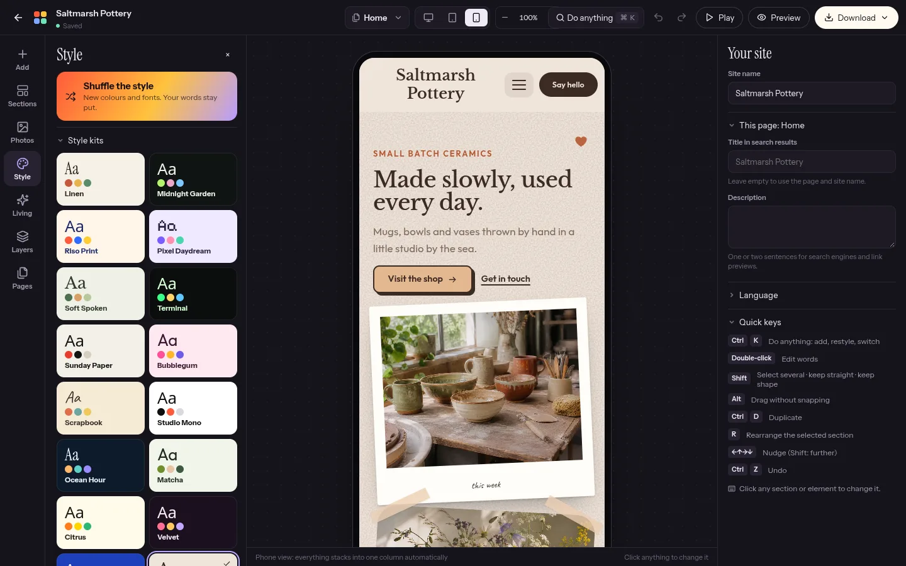

# Make a site (Quilt)

`/?quilt` is where people make whole websites in Patchwork. It works like a poster tool and produces a real website.

## Starting

- **Quick start ("Sew my site").** Pick what you're making (café, portfolio, app, shop, gig, wedding, game, developer, journal), give it a name and an optional one-line description, and pick a feeling (a style kit). The preview updates live. One click makes a whole site about you, with the right sections and your words already in it.
- **Templates.** Nine complete sites, shown as live thumbnails.
- **Blank page.** One centred opening section in the chosen style.
- **Import a project.** A `.quilt.zip` downloaded from another computer.

## Editing

| Where | What |
|---|---|
| **Canvas** | Click to select, Shift-click or drag a box to select several, drag to move (snaps to the grid, the middle and other elements; Alt turns snapping off), handles to resize (corners keep proportions for pictures and shapes), the round handle to rotate (Shift snaps to 15°). Double-click words to type. Each section has a bar for **Rearrange**, move, duplicate and delete, and a handle to change its height. **+ Add section** sits between sections. |
| **Add** | 12 text styles (heading, highlighter, handwritten, outline, gradient, stamp, retro, pixel…), 6 buttons, 9 working parts, 37 shapes and doodles, 7 lines and 51 icons. Click to add, or drag straight onto the page. |
| **Sections** | 16 kinds of section and 36 layouts in all, shown in *your* current style. |
| **Photos** | Your uploads (kept on this device) and Patchwork's own photos and paintings. Click to add or to replace the selected picture; the small button sets a section background. |
| **Style** | Shuffle the style, 16 kits, edit any of the 7 brand colours, make a palette from one colour, swap light and dark, 10 font pairings, corners and shadows. |
| **Living** | Put one of 16 living Patchwork scenes behind a section, move residents (fox, hedgehog, ghost, jellyfish…) into it, and switch on the kite back-to-top, the reading thread, a soft fade-in or a cursor trail. |
| **Layers** | Sections on the page (show or hide) and the elements of the selected section (order, lock, hide). |
| **Pages** | Add, rename (double-click), duplicate, delete, choose the home page. Shared header and footer. Menus set to "My pages" update by themselves. |
| **Inspector** | Everything about the selection, in tabs: **Design**, **Motion** (13 entrances, 6 loops, 5 hover effects, parallax), **Link** (page, section, website, email, phone) and **Phone**. For a section: Rearrange, background (colour, gradient, mesh, photo with a colour wash, living scene), patterns, the **bottom edge** (wave, zigzag, scallop, torn paper, steps, drip, curve, slant, stitched), height, full-screen, sticky header. |
| **Ctrl K** | Do anything by typing: add any section or element, restyle, switch page or screen size, preview, download. |

Undo and redo cover everything. The site saves itself a moment after every change.

## Phones

Switch to the phone view at the top. Everything stacks into one column in reading order, cards keep their contents, and big type shrinks more than small type. Per element you can hide it on phones, show it only on phones, move it earlier or later, and set its text size. Per section you can set the spacing and alignment. See [the engine](../engines/quilt.md#phones) for how the order is worked out.

## Downloading

- **Website.** A zip with one HTML file per page, `quilt.css`, `quilt.js` (about 3 KB), and only the fonts, photos, uploads, scenes and spirits the site uses, plus their licences. It opens straight from disk and works on any static host. It makes no network requests.
- **Editable project.** `site.json` plus your uploads, to back up or continue on another computer.

## What makes it different

1. You place things freely, and Patchwork writes a real responsive grid, not absolutely positioned boxes.
2. Phone layouts are worked out from how you'd read the page, and cards keep their contents together.
3. **Rearrange** gives a section a new layout without losing a word.
4. **Shuffle the style** restyles the whole site, because every colour is a brand token.
5. **Living scenes, residents and seams** come from Patchwork's own collections, and they come with you in the download.
6. Nothing is hosted and there's no account. The site is a folder you own.
