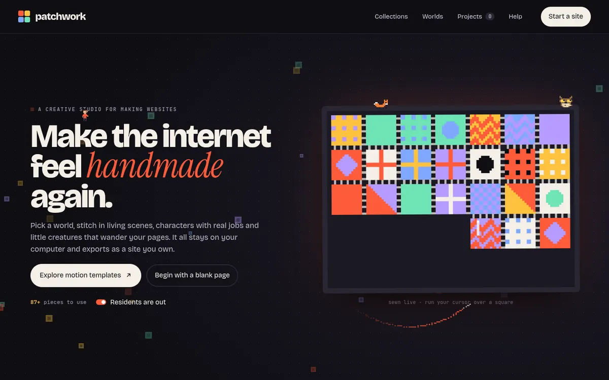
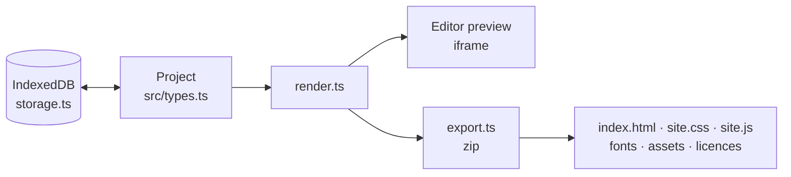

# The studio: make a website, take it with you

> `src/App.tsx` (home, dashboard, editor) · `src/render.ts` (one renderer) · `src/export.ts` · `src/storage.ts` · `src/catalog.ts` (worlds, sections, backgrounds, motion)

The studio is the reason the rest exists: a place where someone who has never written HTML makes a site that looks handmade, then downloads it.

## Making a site

1. **Pick a world.** Four starting looks, each with its own type, colours, decorations and sprites: *Pixel daydream*, *After hours* (a terminal), *Paper & things* (a scrapbook) and *Soft spoken* (editorial).
2. **Add sections.** Hero, About, Projects, Skills, Contact and Footer. Reorder them, duplicate them, and give each its own world if you like.
3. **Dress them.** Words, colours, fonts (eight pairings), an uploaded image, decorations from the world, a background (including the five [ASCII scenes](../engines/ascii.md)), and a motion: still, reveal, hover lift, float, sprite idle, cursor tracking or click feedback.
4. **Living site.** One switch, and the site follows each visitor's clock: dawn colours in the morning, a starry night after dark, the aurora only at night. The editor can preview any hour.
5. **Check it.** A phone preview, and undo and redo.

## Taking it away

- **Export** downloads a finished site: `index.html`, `site.css`, `site.js` (the ASCII runtime and a small motion script), fonts, images and licences. It makes no network requests and opens from a folder.
- **Download editable project** saves a bundle that *Import* can open again on any machine.

## How it fits together

- **A project** is a list of sections. Each has a kind, a world, words, an optional background, decorations and motion. The format is version 1; new fields are optional, and retired backgrounds map to their replacements, so old projects keep opening.
- **One renderer.** `render.ts` produces the same markup, scoped under `.pw-*`, for the preview and the export. There is no editor-only site behaviour.
- **Local first.** Projects and uploads live in IndexedDB on the visitor's device. Uploads are referenced as `asset:<uuid>` and never as blob URLs. Imports go through `validateProject`, and links through `safeLink`.
